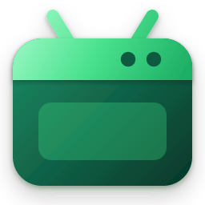
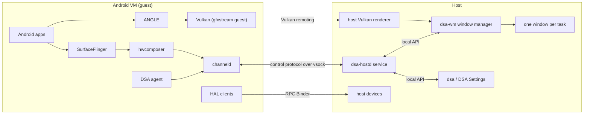

<div align="center">



# Desktop Subsystem for Android™

**Android apps as real desktop windows, on an open-source stack.**

[](https://github.com/thisisthepy/desktop-subsystem-for-android/actions/workflows/test.yml)
[](https://github.com/thisisthepy/desktop-subsystem-for-android/actions/workflows/test-installer.yml)
[](https://github.com/thisisthepy/desktop-subsystem-for-android/actions/workflows/test-image.yml)
[](https://github.com/thisisthepy/desktop-subsystem-for-android/actions/workflows/test-kernel.yml)
[](https://github.com/thisisthepy/desktop-subsystem-for-android/releases/latest)
[](https://github.com/thisisthepy/desktop-subsystem-for-android/blob/main/LICENSE)

**English** · [한국어](https://github.com/thisisthepy/desktop-subsystem-for-android/blob/main/docs/locales/README_ko.md)

</div>

> DSA is an independent open-source project. It is not affiliated with, endorsed by or
> sponsored by Microsoft or Google. Android is a trademark of Google LLC. Windows is a
> trademark of the Microsoft group of companies.

## What it is

DSA runs Android in a lightweight VM of its own and shows each Android task in a native
desktop window. Each app has its own taskbar button, Start menu entry, notifications and
entry in the list of installed apps, as it did with the Windows Subsystem for Android
(WSA), which Microsoft ended on March 5, 2025. Every part of DSA is open source, so anyone
can carry it on.

**Status: preview.** DSA v0.1 runs on Windows 11 x64. The features below are implemented
and tested in CI; checking them by hand on real hardware is still in progress, so expect
rough edges. Linux, macOS and ARM64 Windows are in progress (see
[Supported platforms](#supported-platforms)).

## Features

**Windows and input**

- One native window per Android task, drawn as the app, with the app's own program name and
  icon in the taskbar, Alt+Tab and Task Manager. No emulator frame showing the whole screen.
- Windows 11 caption buttons over the app, snap layouts, live resize without recreating
  the app, and sharp output at every monitor scale.
- Mouse, touch and pen (pressure, eraser, barrel button), keyboard with every layout, and
  the Windows input method, including Korean, through the Android editor.
- Windows exposed to UI Automation, so screen readers can reach them.

**Shell integration**

- Start menu shortcuts and Windows search for every Android app, even while Android is
  stopped; apps listed under Settings > Apps > Installed apps, where they can be uninstalled.
- Android notifications as Windows toasts under each app's name and icon; clicking one opens
  the app, dismissing one dismisses it in Android.
- Apps that run in the background as notification area icons, with media keys and the media
  flyout for apps that play media.
- Android widgets placed on the desktop.
- Text clipboard shared both ways, links opened in the host browser, host files opened and
  shared into Android apps, shared folders.
- APK install by double-click, from the context menu, or with `dsa install`.

**System**

- Android's Doze as the idle state, so notifications keep arriving while the CPU rests, and
  idle memory returned to the host. Freezing Android is an option, off by default.
- Host devices lent to Android: GPU (Vulkan remoting through gfxstream, OpenGL ES through
  ANGLE), audio, video codecs, microphone, camera, location, sensors and power.
- An ARM translation layer for ARM-only apps on x64: the open source translator Digitalis
  comes with the x64 image, and Google's translator or another package can replace it.
- Signed automatic updates of both the Android image and DSA itself, with a failed image
  rolled back to the last good one.
- Each Windows user gets their own Android and data disk, in their own profile.
- DSA Settings: apps, background apps, widgets, display and GPU, memory, network, device
  identity, updates, developer mode with adb, Android's live log and diagnostics.

**Not shipped:** Google Play services or an app store (their licences make them a user's
choice), and any of Microsoft's WSA binaries. A user who wants Google Play installs it from
DSA Settings or with `dsa gapps install`: DSA then downloads the public LiteGapps Core package
for that user's Android and lays it over the system. Google's apps follow Google's terms.

## Supported platforms

| Host | Status |
|---|---|
| Windows 11, x64 | Preview. Released as `DSA-v<version>-win-x64-setup.exe` |
| Windows 11, ARM64 | In progress. Builds and installs in CI; not released yet |
| Linux (x64, ARM64) | In progress. The KVM host, Wayland compositor and `.deb`/`.rpm` packages build and run in CI; not released yet |
| macOS (Apple silicon) | In progress. The host on Apple's Virtualization framework and its app bundle build in CI; not released yet |

### Android versions

DSA supports the newest two Android major versions: today Android 16 and Android 17. A
version leaves support when the second newer major ships, so Android 16 is supported until
Android 18 is released. The image updater moves each user to a supported version and never
to a lower major on its own. You can choose either supported version in the settings app
or with `dsa android use`; moving to the older one erases the Android data, because Android
cannot read data a newer version wrote.

<p align="center">
  
</p>

Dates after today are expected dates, not releases.

## Install

1. Turn on the Windows feature **Virtual Machine Platform** and restart.
2. Download `DSA-v<version>-win-x64-setup.exe` from the
   [latest release](https://github.com/thisisthepy/desktop-subsystem-for-android/releases/latest)
   and check it against `SHA256SUMS.txt`.
3. Run it. Setup installs the `DsaHost` service, the `dsa` command, DSA Settings, and the
   first Android image (downloaded when setup does not carry one). Android starts when you
   sign in.

No kernel to build and no change to your WSL setup: DSA ships its own kernel and its own VM.
Uninstalling removes everything DSA wrote except each user's Android disk.

## Quick start

Open an Android app from the Start menu, or use the `dsa` command:

```
dsa status                          # Android's state and any pending update
dsa install app.apk                 # install an APK, or a split-APK bundle (.xapk, .apks, .apkm)
dsa apps list                       # the installed apps
dsa launch com.android.settings     # open an app in its own window
dsa settings set clipboard off      # change a setting (DSA Settings has the same switches)
dsa logcat -d -b all *:W            # Android's log, warnings and above
dsa logs collect -o diag.zip        # everything a problem report needs, as one zip
```

`dsa` with no arguments lists every command. Android's log stays in memory and flows to the
host only while something reads it. Attach `diag.zip` to a problem report.

## User guides

Step-by-step guides cover installing, apps and windows, APKs, files, Android versions,
settings, memory, developer mode, troubleshooting and uninstalling:
[docs/guides](docs/guides/README.md). The [introduction page](docs/guides/intro/index.html)
explains the project for newcomers.

## Architecture



- **Guest.** A platform-signed agent makes the display freeform and reports tasks, apps
  and notifications. The hwcomposer hands each task's layers to the host as its own
  display. The HAL clients reach host devices over RPC Binder. There is no launcher,
  status bar or keyboard app: the host is the shell.
- **Protocol.** One definition, `dsa/protocol/control.proto`, with codecs generated for
  Rust, Java and C++. Every connection checks the protocol version, the schema hash and a
  per-boot secret.
- **Host.** `dsa/host/core/` is platform neutral: sessions, the app registry and the
  lifecycle policy. Each OS adds the VM, the transport and the window system under
  `dsa/host/platform/<os>/`. On Windows the VM is created through the Host Compute System,
  and frames go from the GPU to each window through Direct3D 11 and DirectComposition,
  never through the CPU.

## Building from source

The Rust crates form one workspace in `dsa/`:

```
cd dsa
cargo test --workspace
cargo build -p dsa-host-windows --release
```

Other parts have their own build, described next to them:

- the installer: `dsa/host/platform/windows/installer/README.md`
- the Windows host: `dsa/host/platform/windows/README.md`
- the guest kernel: `dsa/kernel/`
- the Android image and guest components: `dsa/guest/`
- the graphics path: `dsa/graphics/`

Upstream projects (AOSP, gfxstream, the kernel) are not vendored: scripts fetch a pinned
revision and apply the patches kept here. Python tools run with `uv run`.

## Repository layout

| Path | What it holds |
|---|---|
| `dsa/protocol/` | The guest-host control protocol and its code generators |
| `dsa/host/core/` | The platform-neutral host |
| `dsa/host/cli/` | The `dsa` command |
| `dsa/host/platform/windows/` | The Windows host, window manager, installer and DSA Settings |
| `dsa/host/platform/linux/`, `macos/`, `unix/` | The Linux and macOS hosts and what they share |
| `dsa/graphics/` | Vulkan remoting, starting from gfxstream |
| `dsa/guest/` | The agent, hwcomposer, HAL services and the image configuration |
| `dsa/kernel/` | The guest kernel configuration and build |
| `scripts/tests/` | Repository checks |
| `.github/` | CI workflows, release scripts and the README's assets |

## Contributing

Work happens on the `develop` branch; `main` is published from it. Open pull requests
against `develop`, with one logical change per commit and a test for every behaviour
change. Generated protocol code is never edited by hand. Please do not use em dashes in
text: a repository check rejects them.

## License

[Apache-2.0](https://github.com/thisisthepy/desktop-subsystem-for-android/blob/main/LICENSE).
Each shipped third-party component keeps its own licence, listed in the installer.

## Trademarks

Android is a trademark of Google LLC. Windows is a trademark of the Microsoft group of
companies. DSA is not affiliated with, endorsed by or sponsored by Microsoft or Google.
