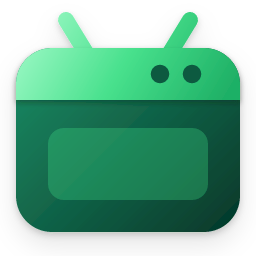
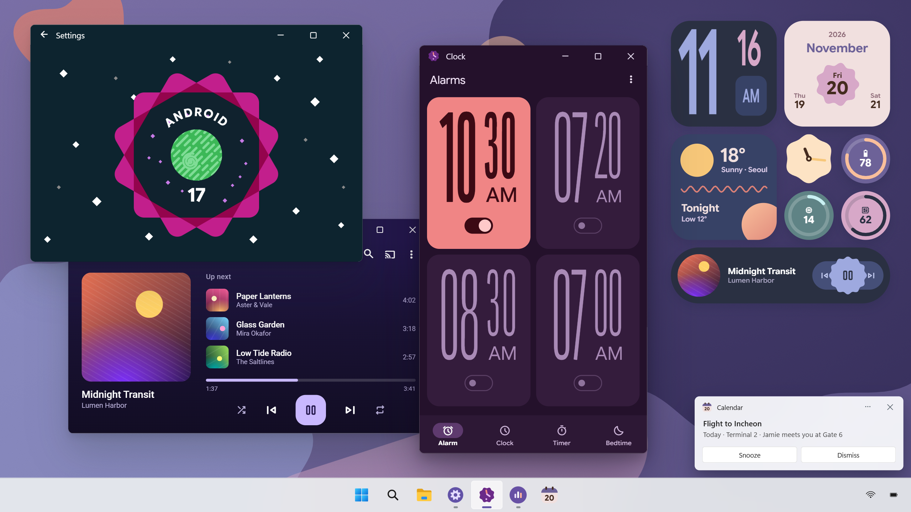
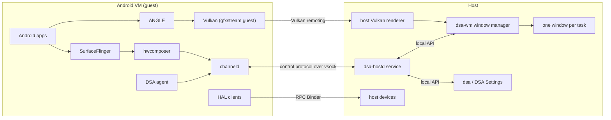

<div align="center">



# Desktop Subsystem for Android™

**Android apps as real desktop windows, on an open-source stack.**

[](https://github.com/thisisthepy/desktop-subsystem-for-android/actions/workflows/test.yml)
[](https://github.com/thisisthepy/desktop-subsystem-for-android/actions/workflows/test-installer.yml)
[](https://github.com/thisisthepy/desktop-subsystem-for-android/actions/workflows/test-image.yml)
[](https://github.com/thisisthepy/desktop-subsystem-for-android/actions/workflows/test-kernel.yml)
[](https://github.com/thisisthepy/desktop-subsystem-for-android/releases/latest)
[](https://github.com/thisisthepy/desktop-subsystem-for-android/blob/main/LICENSE)

**English** · [한국어](docs/locales/README_ko.md) · [日本語](docs/locales/README_ja.md) · [简体中文](docs/locales/README_zh-CN.md) · [繁體中文](docs/locales/README_zh-TW.md) · [Español](docs/locales/README_es.md) · [Français](docs/locales/README_fr.md) · [Deutsch](docs/locales/README_de.md) · [Português (Brasil)](docs/locales/README_pt-BR.md) · [Русский](docs/locales/README_ru.md) · [Italiano](docs/locales/README_it.md) · [Tiếng Việt](docs/locales/README_vi.md) · [Bahasa Indonesia](docs/locales/README_id.md) · [Türkçe](docs/locales/README_tr.md)

</div>

> DSA is an independent open-source project. It is not affiliated with, endorsed by or
> sponsored by Microsoft or Google. Android is a trademark of Google LLC. Windows is a
> trademark of the Microsoft group of companies.

## What it is

<p align="center">
  <br>
  <sub>DSA concept image</sub>
</p>

DSA runs Android in a lightweight VM of its own and shows each Android task in a native
desktop window. Each app has its own taskbar button, Start menu entry, notifications and
entry in the list of installed apps, as it did with the Windows Subsystem for Android
(WSA), which Microsoft ended on March 5, 2025. Every part of DSA is open source, so anyone
can carry it on.

**Status.** DSA runs on Windows 11, on x64 and ARM64 PCs. Releases below 1.0 are
pre-releases; from 1.0, releases come in a stable and a pre-release channel (see
[Updates and release channels](#updates-and-release-channels)). Features are tested in CI,
and checking them by hand on real hardware goes on with every release, so please report
what you find. Linux and macOS are in progress and not released (see
[Supported platforms](#supported-platforms)).

**DSA 1.0 is here.** The first stable release brings Android apps back to the Windows
desktop. [Watch the launch film](https://www.youtube.com/watch?v=4VgRY6QKiwM).

## Supported platforms

| Host | Status |
|---|---|
| Windows 11, x64 | Released as `DSA-v<version>-win-x64-setup.exe` |
| Windows 11, ARM64 | Released as `DSA-v<version>-win-arm64-setup.exe`. Android is ARM64 too, so ARM apps run without translation |
| Linux (x64, ARM64) | In progress, not released. The KVM host, the Wayland compositor and the `.deb` and `.rpm` packages build and run in CI |
| macOS (Apple silicon) | In progress, not released. The host on Apple's Virtualization framework and its app bundle build in CI |

### Android versions

DSA supports the newest two Android major versions: today Android 16 and Android 17. A
version leaves support when the second newer major ships, so Android 16 is supported until
Android 18 is released. The image updater moves each user to a supported version and never
to a lower major on its own. You can choose either supported version in DSA Settings or
with `dsa android use`; moving to the older one erases the Android data, because Android
cannot read data a newer version wrote.

<p align="center">
  
</p>

Dates after today are expected dates, not releases.

## Features

**Windows and input**

- One native window per Android task, drawn as the app, with the app's own program name and
  icon in the taskbar, Alt+Tab and Task Manager. No emulator frame showing the whole screen.
- A title bar that is part of the app: the app's colours reach the top of the window, the
  Windows 11 caption buttons sit over it, and the app's icon and name are at the left. The
  icon turns into a back arrow when the app can go back. Snap layouts, dragging,
  double-click to maximize and the window menu (Alt+Space) work as in any Windows app.
- The window menu adds **Full screen**, **New window** (for apps that allow several),
  **Screenshot**, **Aspect ratio**, **Open by default** and **App info**.
- Live resize without recreating the app, and maximize that fills the monitor's work area.
- An app's full screen request, such as a video player's full screen button, fills the
  screen; the title bar appears when the pointer touches the top edge. Apps that only hide
  their bars, such as a feed of short videos, stay in their window. Both are a choice in DSA
  Settings, for all apps or for each app, and F11 always switches full screen.
- Sharp output on every monitor. When you move an app to a monitor of another scale, it
  redraws at the new scale as soon as its window gets there, or DSA scales its window
  instead, as you choose for each app; by default an app that says it handles a change of
  scale redraws, and DSA scales any other. Apps known to break when their scale changes
  while they run, such as YouTube, are scaled by DSA by default.
- Text in apps follows the Windows text size setting.
- Mouse (with hover), touch with up to ten fingers, pen (pressure, eraser, barrel button),
  and the keyboard with every layout.
- Text input through the Windows text services framework (TSF): your Windows input method,
  Korean included, composes inline in the Android editor, with the candidate window next to
  the cursor. Reconversion, the touch keyboard, voice typing
  (Win+H), handwriting and the emoji panel work on the editor's own text. There is no
  Android keyboard app.
- Files dragged between File Explorer and app windows, both ways.
- Windows 11's three- and four-finger touch gestures turned off while a DSA window is in
  front (on by default), so the app gets them.
- Each app's accessibility tree exposed to Windows UI Automation, for screen readers and
  automation tools (see [UI Automation](#ui-automation) and
  [Accessibility](#accessibility)).

**Shell integration**

- Start menu entries and Windows search for every Android app, even while Android is
  stopped; apps listed under Settings > Apps > Installed apps, where they can be uninstalled.
- Desktop shortcuts, and the app's own shortcuts (such as a messenger's new chat) in its
  taskbar and Start menu jump list. When an app is renamed, its Start menu entry, desktop
  shortcuts and taskbar pin follow the new name.
- Android notifications as Windows notifications under each app's name and icon; selecting
  one opens the app, dismissing one dismisses it in Android.
- Apps that run in the background as notification area icons, with media keys and the
  Windows media controls for apps that play media.
- Android widgets placed on the desktop, each in a window of its own.
- Text clipboard shared both ways, web links opened in the Windows browser, Windows files
  opened in and shared into Android apps, and your Windows folders shared with Android.
- Android's files in File Explorer, under **Android** in the navigation pane.
- APK install by double-click, from the context menu, by dropping the file on a window, or
  with `dsa install`, with a window that shows what the APK is before Android starts.
- "Share on PC" in Android's share sheet: text, links and files go to the Windows share
  window, Nearby sharing included.

**Media and devices**

- Audio through the Windows default output and input devices, with a line for each app in
  the volume mixer.
- Video decoded on the host GPU through Media Foundation: H.264, HEVC, VP9 and AV1, up to
  4096x2304. Decoded pictures reach Android through a memory region the host and the VM
  share, rather than being copied over the video channel. Formats the GPU does not decode
  are decoded in Android in software.
- GPU rendering on the host: Vulkan remoting through gfxstream, and OpenGL ES through ANGLE
  on top of it.
- Camera, microphone, location, sensors (accelerometer, gyroscope, orientation, light) and
  power, each behind both the Windows privacy settings and Android's permissions.
- Android's network location answered by the host, with or without Google Play. Without
  Google Play, address lookups (`Geocoder`) are answered on the computer from administrative
  boundary data that comes with DSA: a position becomes its country, province and city, and
  in Korea its district and neighbourhood. No server and no key are involved, and the
  position stays on the computer. Street addresses, and turning an address into a position,
  are not offered. With Google Play, Google's geocoder answers.

**System**

- Android's Doze as the idle state: 30 seconds after the last Android window closes or is
  minimized, Android dozes, notifications keep arriving while the CPU rests, and idle memory
  goes back to Windows while Android runs. Opening an app wakes it at once, with no boot to
  wait for. Freezing Android is an option, off by default.
- Each Windows user gets their own Android and data disk, in their own profile.
- Root access like `sudo`, off by default. An administrator turns it on; then each app, and
  `adb shell` in developer mode, can be set to ask. A request shows the Windows
  administrator prompt (UAC) under the app's own name and icon, and an approval lasts 15
  minutes. Apps that are not allowed cannot see `su` at all. Every request is logged.
- Backup of apps' data to your user folder, encrypted, off by default.
- DSA Settings: apps and their windows, background apps, widgets, display and GPU, memory,
  network, device identity, updates, add-ons, root access, developer mode with adb,
  Android's live log and diagnostics. Everything in it is also a `dsa` command.

**Add-ons you choose**

DSA ships no Google software. Each of these is downloaded from its source only when you ask
for it, after DSA shows you the source and the terms, and goes on a disk of add-ons beside
Android. The system image is never changed, and each one can be removed again from DSA
Settings or the command line.

- **Google Play.** `dsa gapps install`, or **Advanced** > **Google Play** in DSA Settings,
  downloads the public LiteGapps Core package (Google Play services, the Play Store and
  account sync) for your Android version. This Android is not Google-certified, so Google
  may ask you to register the device; DSA Settings shows the Android ID and the page to do
  it. Google Play never keeps Android from starting. Google's apps follow Google's terms.
- **Widevine L3.** `dsa drm widevine install`, or **Advanced** > **Protected content**,
  takes Google's Widevine module, unchanged, from Google's Android emulator image for your
  Android version (about 2 GB to download; only Widevine is kept). Streaming apps can then
  play protected video. At security level L3, streaming services send standard definition
  at most, so watch in high definition in a Windows browser or app.
- **ARM translation.** On x64 PCs, apps built only for ARM run through a translator. The
  open source translator [Digitalis](https://digitalisx64.github.io/) comes with the x64 image and is used from the first
  start. You can replace it with Google's translator (`dsa arm-translation fetch google`)
  or a package of your own. Only 64-bit ARM apps (`arm64-v8a`) run. On ARM64 PCs, Android
  runs ARM apps itself.

**Not shipped:** Google Play services, an app store or any other Google binary (their
licences make them a user's choice), and any of Microsoft's WSA binaries.

## UI Automation

DSA exposes the user interface inside each Android app window to Windows UI Automation
(UIA), the same interface Windows apps use. Screen readers, test tools and other UIA
clients see an Android app's buttons, lists and text fields as elements of its window,
rather than one picture.

**How it works.** When a UIA client first asks a DSA app window for its tree, the window
asks DSA's agent in Android to watch that task. The agent reads Android's accessibility
nodes for that task only and sends them to the host: first the whole tree, then the
changes. The host keeps the tree in the window process, so every property read and every
navigation call is answered locally, without a round trip to the VM. When no UIA client
has listened for 30 seconds, the watch stops, and Android stops reading nodes. Users who
use no UIA client pay nothing for it.

**What each element carries.**

- **Control type**, from the Android view class and its state: button, check box, radio
  button, edit, slider, progress bar, combo box, list, list item, tab, menu, image, text,
  document (for a `WebView`), toolbar and group. An Android switch is a button with the
  Toggle pattern, and a heading is text.
- **Name**: the content description, else the text, else the hint of an empty edit field.
  A clickable element with no name of its own takes the names of its children.
- **AutomationId**: the Android view's resource ID, such as `com.example:id/send`.
- **ClassName**: the Android view class. **FrameworkId** is `Android`.
- **HelpText** (the hint), **ItemStatus** (Android's state description), **IsEnabled**,
  **IsKeyboardFocusable**, **HasKeyboardFocus**, **IsPassword** and a **BoundingRectangle**
  in screen coordinates.
- Elements Android reports as not visible to the user are left out of the tree.
- Password fields never leave Android as text: each character arrives as a bullet.

**Patterns and what they do in Android.**

| UIA pattern | Android action |
|---|---|
| Invoke | `ACTION_CLICK` |
| Value (`SetValue`) | `ACTION_SET_TEXT`, which replaces the field's whole text |
| Toggle | `ACTION_CLICK` |
| SelectionItem (`Select`) | `ACTION_SELECT`, or `ACTION_CLICK` when the node has no select action |
| Scroll | `ACTION_SCROLL_FORWARD` and `ACTION_SCROLL_BACKWARD`, by page; no scroll percentage |
| `SetFocus` | `ACTION_FOCUS`, or `ACTION_ACCESSIBILITY_FOCUS` when the node cannot take input focus |

These actions go to the node directly. They do not move the mouse or inject touches.

**Events.** The window raises focus changed (while it is in front), structure changed when
children appear or go, and property changed for the name, value, toggle state, selection,
enabled state and bounding rectangle. Events are raised only while a client listens.

**Text input.** `SetValue` sets a field's text in one step. Typing, composition and
input methods go through TSF and the app's `InputConnection` instead, as for a person at the
keyboard.

**The window itself.** The window's name is the app's name. The caption buttons (minimize,
maximize or restore, close) and the title bar's back arrow are named buttons in the tree.

**Using it from other tools.** Any UIA client works, such as Inspect and Accessibility
Insights for Windows, or libraries such as FlaUI. Find the app's window by its name, then
its elements by AutomationId, name or control type. For scripts that need to press a point
rather than an element, `dsa tap <package> <x> <y>` presses inside the app's task.

**Not there yet.** There is no Text pattern, no RangeValue or ExpandCollapse pattern, no
long press through UIA, no heading level, and no notification or live region events.
Android's accessibility focus is not exported; only input focus is. Improvements are tracked
in issue [#744](https://github.com/thisisthepy/desktop-subsystem-for-android/issues/744)
(open).

## Accessibility

**Screen readers.** NVDA and Narrator read Android apps through the UI Automation tree
above: controls have names and roles, focus follows the keyboard, and buttons, switches,
lists and text fields can be used without a mouse. JAWS uses the same tree; the project has
not checked it yet, so reports are welcome.

**What is being improved.** These come from a screen reader user's report, issue
[#744](https://github.com/thisisthepy/desktop-subsystem-for-android/issues/744). Each is
open, tracked there:

- **Faster focus.** Today a focus change waits in Android before it reaches Windows, about
  250 to 450 ms after a key press, and holding an arrow key moves at about four steps a
  second. The plan is to send focus changes at once, read only the task an event came from,
  and keep the short timings to times when a UIA client listens.
- **Accessibility focus.** Only input focus is exported today, so moves of Android's
  accessibility focus raise no focus event.
- **Text pattern.** Edit fields have no Text pattern yet, which NVDA uses to read and review
  text by character, word and line. Their value can be read and set.

**DSA's own windows.**

- **DSA Settings** works with the keyboard and screen readers: its navigation, rows and
  controls are UIA elements with names.
- **The APK Installer** names each of its elements, and its **More** link expands and
  collapses through UIA.
- **Widgets on the desktop** take keyboard focus. Enter, Space, the menu key and Shift+F10
  open the widget's menu.
- **Menus** of widgets and notification area icons are UIA menus with keyboard navigation,
  and **confirmation dialogs** have access keys and a default button.
- **The root prompt** is Windows' own administrator prompt (UAC).
- Caption buttons use the system colours in a high contrast theme.

On Linux, the host exports the same tree to AT-SPI, with text by character, word and line,
for Orca; Linux is not released yet. The macOS host does not export app trees yet.

**Reporting a problem.** Open an
[issue](https://github.com/thisisthepy/desktop-subsystem-for-android/issues/new) with the
screen reader and its version, the app, what you did, what you heard and what you expected.
A diagnostic bundle from `dsa logs collect -o diag.zip` helps. The
[DSA Discord](https://discord.gg/MtpQnR4eQQ) is open for questions too.

## Install

**You need** Windows 11 on an x64 or ARM64 PC, with the Windows feature **Virtual Machine
Platform** turned on. Setup checks for it and stops with instructions if it is off.

1. Turn on **Virtual Machine Platform**: Settings > System > Optional features > More
   Windows features, or `dism /online /enable-feature /featurename:VirtualMachinePlatform /all`
   in an administrator terminal. Restart.
2. Download `DSA-v<version>-win-x64-setup.exe`, or `DSA-v<version>-win-arm64-setup.exe` on
   an ARM64 PC, from the [latest release](https://github.com/thisisthepy/desktop-subsystem-for-android/releases/latest)
   and check it against `SHA256SUMS.txt`.
3. Run it. Setup installs the `DsaHost` service, the `dsa` command, DSA Settings, the APK
   Installer and the first Android image (downloaded when setup does not carry one).
   Android starts when you sign in, so the first app you open does not wait for a boot.

No kernel to build and no change to your WSL setup: DSA ships its own kernel and its own VM.
Uninstalling removes everything DSA wrote except each user's Android disk.

## Updates and release channels

DSA updates itself and the Android image. Both are signed, and nothing is applied whose
signature, size or hash does not match.

- **DSA itself.** The service checks a signed list of releases and installs a newer version
  when no user's Android is running; otherwise it waits, and `dsa update` installs at once.
  You are told before and after. An update never moves DSA to a lower version.
- **Channels.** From 1.0 there are two: **stable**, and **pre-release** for versions still
  being finished. The pre-release channel takes whichever of the two is newer. Your channel
  starts from the installer you used, and upgrades keep it. Change it with **Get pre-release
  versions** on the **Updates** page of DSA Settings, or
  `dsa settings set prerelease-updates on|off` (administrators). Leaving pre-releases never
  moves DSA back: it waits for a newer stable release. Every release before 1.0 is a
  pre-release.
- **Android image.** Image updates do not depend on the channel. An image that fails to
  boot is replaced by the last good one, and `dsa status` says so. With **Restart Android
  into updates by itself**, Android restarts into a downloaded update when no app window is
  open.
- **Turning updates off.** Administrators can turn off **Update DSA automatically** and
  **Update the Android image automatically** on the **Updates** page.

Stable releases are made only from `main`, after review. Builds of `develop` are
pre-releases or test builds for contributors.

## Quick start

Open an Android app from the Start menu, or use the `dsa` command:

```
dsa status                          # Android's state and any pending update
dsa install app.apk                 # install an APK, or a split-APK bundle (.xapk, .apks, .apkm)
dsa apps list                       # the installed apps
dsa launch com.android.settings     # open an app in its own window
dsa settings set clipboard off      # change a setting (DSA Settings has the same switches)
dsa logcat -d -b all *:W            # Android's log, warnings and above
dsa logs collect -o diag.zip        # everything a problem report needs, as one zip
```

`dsa` with no arguments lists every command. Android's log stays in memory and flows to the
host only while something reads it. Attach `diag.zip` to a problem report.

## Limits

These are true today:

- Only Windows is released. Linux and macOS are in progress.
- DSA Settings shows in English and Korean only.
- Only 64-bit apps run: `arm64-v8a` and, on x64, `x86_64`. 32-bit apps do not run.
- Widevine is L3, so protected streams play in standard definition at most.
- Google Play is not Google-certified on DSA; Google may ask you to register the device.
- The clipboard shares text only.
- The **System (forced)** scaling choice is not available yet and works like **System**.
- The UI Automation export has the gaps listed under [UI Automation](#ui-automation).
- Address lookups without Google Play give the area (country down to city, or district in
  Korea), not street addresses.

## User guides

Step-by-step guides cover installing, apps and windows, APKs, files, Android versions,
settings, memory, developer mode, troubleshooting and uninstalling:
[docs/guides](docs/guides/README.md). The [introduction page](docs/guides/intro/index.html)
explains the project for newcomers.

## Architecture



- **Guest.** A platform-signed agent makes the display freeform and reports tasks, apps,
  notifications and accessibility trees. The hwcomposer hands each task's layers to the
  host as its own display. The HAL clients reach host devices over RPC Binder. There is no
  launcher, status bar or keyboard app: the host is the shell.
- **Protocol.** One definition, `dsa/protocol/control.proto`, with codecs generated for
  Rust, Java and C++. Every connection checks the protocol version, the schema hash and a
  per-boot secret.
- **Host.** `dsa/host/core/` is platform neutral: sessions, the app registry and the
  lifecycle policy. Each OS adds the VM, the transport and the window system under
  `dsa/host/platform/<os>/`. On Windows the VM is created through the Host Compute System,
  and frames go from the GPU to each window through Direct3D 11 and DirectComposition,
  never through the CPU.

## Building from source

The Rust crates form one workspace in `dsa/`:

```
cd dsa
cargo test --workspace
cargo build -p dsa-host-windows --release
```

Other parts have their own build, described next to them:

- the installer: `dsa/host/platform/windows/installer/README.md`
- the Windows host: `dsa/host/platform/windows/README.md`
- the guest kernel: `dsa/kernel/`
- the Android image and guest components: `dsa/guest/`
- the graphics path: `dsa/graphics/`

Upstream projects (AOSP, gfxstream, the kernel) are not vendored: scripts fetch a pinned
revision and apply the patches kept here. Python tools run with `uv run`.

## Repository layout

| Path | What it holds |
|---|---|
| `dsa/protocol/` | The guest-host control protocol and its code generators |
| `dsa/host/core/` | The platform-neutral host |
| `dsa/host/cli/` | The `dsa` command |
| `dsa/host/platform/windows/` | The Windows host, window manager, installer and DSA Settings |
| `dsa/host/platform/linux/`, `macos/`, `unix/` | The Linux and macOS hosts and what they share |
| `dsa/graphics/` | Vulkan remoting, starting from gfxstream |
| `dsa/guest/` | The agent, hwcomposer, HAL services and the image configuration |
| `dsa/kernel/` | The guest kernel configuration and build |
| `scripts/tests/` | Repository checks |
| `.github/` | CI workflows, release scripts and the README's assets |

## Contributing

DSA is young and still being stabilized, so every report helps, whether or not you have a
fix in hand.

<p>
  <a href="https://github.com/thisisthepy/desktop-subsystem-for-android/issues/new"></a>
  <a href="https://discord.gg/MtpQnR4eQQ"></a>
</p>

- **Found a bug or have an idea?** [Open an issue](https://github.com/thisisthepy/desktop-subsystem-for-android/issues/new). Say what you did and
  what happened, with your Windows build (`winver`) and the DSA and Android versions
  (`dsa status`). A diagnostic bundle from `dsa logs collect -o diag.zip` makes a bug much
  easier to track down.
- **Want to ask first or just talk it through?** Come to the
  [DSA Discord](https://discord.gg/MtpQnR4eQQ). Questions, what you are trying to run, and early feedback are all
  welcome there.
- **Sending a change?** Work happens on the `develop` branch; `main` is published from it.
  Open pull requests against `develop`, with one logical change per commit and a test for
  every behaviour change. Generated protocol code is never edited by hand. Please do not use
  em dashes in text: a repository check rejects them.

## License

[Apache-2.0](https://github.com/thisisthepy/desktop-subsystem-for-android/blob/main/LICENSE).
Each shipped third-party component keeps its own licence, listed in the installer.

## Trademarks

Android is a trademark of Google LLC. Windows is a trademark of the Microsoft group of
companies. DSA is not affiliated with, endorsed by or sponsored by Microsoft or Google.

## Star history

<a href="https://www.star-history.com/#thisisthepy/desktop-subsystem-for-android&Date">
  <picture>
    <source media="(prefers-color-scheme: dark)" srcset="https://api.star-history.com/svg?repos=thisisthepy/desktop-subsystem-for-android&type=Date&theme=dark" />
    <source media="(prefers-color-scheme: light)" srcset="https://api.star-history.com/svg?repos=thisisthepy/desktop-subsystem-for-android&type=Date" />
    
  </picture>
</a>
