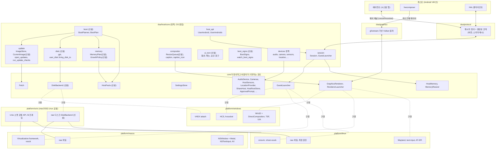
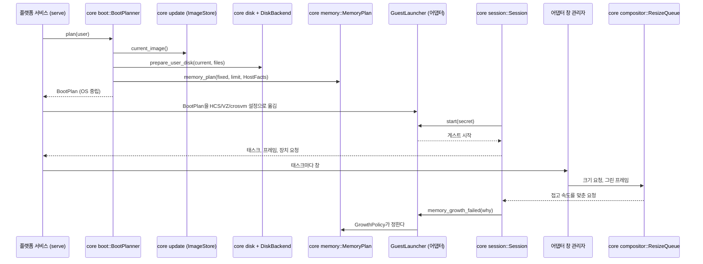

# 호스트 아키텍처: core와 플랫폼 어댑터의 경계

이 문서는 호스트를 `dsa/host/core`(정책)와 `dsa/host/platform/<os>`(어댑터)로 나누는 선을 긋고,
지금 플랫폼마다 따로 있는 정책을 core로 옮기는 순서를 정한다. 근거는 INTENT D9와 AGENTS.md의
"Policy in core, adapters thin (D9)" 규칙이다.

구현은 이 문서의 단계를 하나씩 따라 한다. 단계마다 PR 하나다. 단계 안에서 판단이 필요한 곳은
"구현자가 확인한다"로 적어 두었다. 그 밖의 판단은 하지 않는다.

기준은 세 가지다.

- Windows가 기준 구현이다. Windows의 OS 중립 동작을 core로 옮기고, macOS와 Linux는 얇은
  어댑터로 그 동작을 그대로 쓴다.
- core는 OS API를 부르지 않고, OS 핸들을 들지 않고, `cfg(target_os)`나 `cfg(windows)`로
  갈라지지 않는다. `std::fs`, `std::time`, `std::thread`처럼 모든 OS에 같은 뜻으로 있는 표준
  라이브러리는 OS API로 보지 않는다.
- 플랫폼 crate는 다른 플랫폼도 필요한 규칙, 상태 기계, 큐, 공식, 지역화 문자열의 사본을 갖지
  않는다.

이 문서를 쓴 시점의 기준 커밋은 `feat/refactor-base`(b804229b)다. 줄 번호는 그 커밋 기준이다.
구현자는 줄 번호가 아니라 함수 이름으로 찾는다.

## 1. 구조

### 1.1 계층



### 1.2 흐름



데이터와 제어의 길은 이렇다.

- **세션**: core `Session`이 핸드셰이크, 상태(시작, 지연, 실행, 도즈), 재시작을 가진다. 어댑터는
  `GuestLauncher`로 VM을 켜고 끈다.
- **VM 실행기**: core `BootPlanner`가 이미지, 디스크, 메모리를 정한 `BootPlan`을 만든다. 어댑터는
  그것을 자기 하이퍼바이저 설정으로 옮기기만 한다.
- **컴포지터**: 태스크와 창의 상태, 캡션 규칙, 크기 요청 큐는 core다. 창을 만들고 그리는 일은
  어댑터다.
- **장치**: 장치마다 core가 정책과 포트 trait을 갖고, 어댑터가 OS 장치를 붙인다(이미 대부분 그렇다).
- **파일**: 공유 폴더 정책은 core `file_share`, OS 파일 시스템과 권한은 어댑터다.
- **메모리**: 크기 공식, 증가 정책, 로그 문장은 core다. 물리 메모리 읽기와 VM 크기 바꾸기는
  어댑터다.

## 2. 경계 규칙

### 2.1 공통 규칙

1. OS 차이는 둘 중 하나로 나타낸다. 어댑터가 core에 넘기는 **데이터**(상수, 표, 열거값), 또는
   어댑터가 구현하는 **trait 메서드**다. core 안에서 플랫폼으로 갈라지는 `if`나 `match`는 없다.
   데이터로 넘긴 열거값(`GrowthCeiling::HalfHost` 같은)으로 갈라지는 것은 허용한다. 그것은
   플랫폼이 아니라 정책의 선택지이고, 어느 플랫폼이든 고를 수 있다.
2. 플랫폼 crate가 다른 플랫폼 crate의 파일을 `#[path]`로 끌어오지 않는다. 지금
   `macos/src/lib.rs:67`이 `windows/src/gpt.rs`를, `:73`이 `windows/src/pstore_disk.rs`를 끌어
   온다. 둘 다 core(또는 Unix 공용이면 `platform/unix`)로 옮긴다(단계 9, 10).
3. 로그 문장, 사용자에게 보이는 문장, 지역화 문자열은 정책과 함께 core에 둔다. 어댑터는 OS 고유
   어휘(예: macOS 메뉴의 "Zoom", Windows 시스템 메뉴의 가속키 `(&N)`)만 데이터로 갖는다.
4. core는 `Path`, `PathBuf`, `std::fs`를 쓸 수 있다. 경로를 **고르는** 규칙(어느 폴더에 무엇을
   두는가)은 `HostPaths` 포트로 어댑터가 정한다.
5. 정적 전역 상태(`static DRAWN: Mutex<...>` 같은)를 core에 새로 들이지 않는다. 공유가 필요하면
   `Arc`로 묶은 값을 생성자에서 넘긴다.

### 2.2 영역별 경계

| 영역 | core | 어댑터 |
|---|---|---|
| 이미지 선택 | 현재 이미지 결정, 버전 읽기, 이미지 캐시 정리, 업데이트 저장소 열기, 업데이트 확인 루프 | 내려받기 전송(`Fetch` 구현), 경로 |
| 이미지 구성 | `image.json` 해석, 커널과 디스크 파일 고르기 | 선호하는 디스크 형식과 커널 이름(데이터), 게스트 아키텍처 |
| 사용자 디스크 | 템플릿에서 만들기, 파티션 맞추기, 데이터 초기화, 버전 기록 | 디스크를 열어 `Read + Write + Seek`로 주기(VHDX attach 또는 raw 파일), 파일 권한 |
| 부팅 계획 | `BootPlan` 조립 | `BootPlan`을 HCS/VZ/crosvm 설정으로 옮기기 |
| 메모리 | 시작 크기, 최대 크기, 증가 실패 정책, 로그 | 물리 메모리 읽기, VM 메모리 바꾸기 |
| 크기 요청 | 접기(`coalesce`), 속도 맞추기(`ResizePacer`), 보류와 재큐(`ResizeQueue`) | 창 이벤트를 요청으로 바꾸고, 그린 프레임 알리기, 보낼 스레드 |
| 캡션 | 띠(band)와 배치, 아이콘 선택과 판, 히트 테스트, 접근성 이름 | 그리기, OS 버튼 위치 측정, 접근성 API 연결 |
| 부팅 징후 | 로그 줄에서 징후 찾기, 설명 문장, 감시 루프 | 콘솔 출력 받기 |
| 루트 승인 | 승인 정책과 문구 | OS 승인 창(UAC 대체 창, Authorization Services, polkit) |
| 설정 저장소 | `FileSettings` 열기, 첫 채널 기록 | 설정 폴더 경로, 이전 렌더 GPU 읽는 법 |

### 2.3 이음새의 시그니처

아래는 core에 새로 생기는 공개 항목이다. 이름과 시그니처는 이대로 쓴다. 구현 중 바꿔야 하면
PR 설명에 이유를 적는다.

```rust
// dsa/host/core/src/boot_signs.rs  (단계 1)
pub struct BootSigns { /* windows console_log.rs ConsoleSigns의 필드 그대로 */ }
impl BootSigns {
    pub fn read_line(&mut self, line: &str);
}
pub fn explain_unfinished_boot(signs: &BootSigns, log: &Path) -> String;
pub fn explain_unreachable_agent(signs: &BootSigns, log: &Path, data_disk: &Path) -> String;
pub fn watch_boot_signs(session: Weak<Session>, signs: Arc<Mutex<BootSigns>>);
pub fn guest_traces_input(cmdline: &str) -> bool; // 단계 2

// dsa/host/core/src/memory/sizing.rs 또는 memory.rs 안의 sizing 절  (단계 3, 4)
pub enum GrowthCeiling { HostLessReserve, HalfHost }
pub struct MemoryPlan { pub start_mb: u32, pub max_mb: Option<u64> }
pub fn start_mb(limit_mb: u32) -> u32;
pub fn growth_max_mb(limit_mb: u32, total_mb: Option<u64>, ceiling: GrowthCeiling) -> Option<u64>;
pub fn memory_plan(fixed_mb: Option<u32>, limit_mb: u32, total_mb: Option<u64>,
                   ceiling: GrowthCeiling) -> MemoryPlan;
impl MemoryPlan { pub fn describe(&self, user: &str, limit_mb: u32) -> String; }
pub struct GrowthPolicy { /* grows: bool */ }
impl GrowthPolicy {
    pub fn new() -> GrowthPolicy;
    pub fn grows(&self) -> bool;
    pub fn failed(&mut self, why: &str, start_mb: Option<u64>) -> String; // 로그 문장을 돌려준다
}

// dsa/host/core/src/host_facts.rs  (단계 3)
pub trait HostFacts: Send + Sync {
    /// The computer's physical memory, in KiB; None when it cannot be read.
    fn physical_memory_kb(&self) -> Option<u64>;
}

// dsa/host/core/src/update/current.rs  (단계 5)
pub struct CurrentImage { pub dir: PathBuf, pub version: Option<String> }
impl CurrentImage { pub fn cache_key(&self) -> &str; } // 버전, 없으면 "local"
pub fn current_image(store: Option<&ImageStore>, configured_dir: Option<&Path>)
    -> Result<CurrentImage, String>;
pub fn prune_image_cache(cache_root: &Path, keep: &str);

// dsa/host/core/src/update/service.rs  (단계 6, 7)
pub struct Updates { store, notices, boot_timeout, trial_running, check_now } // windows 정의 그대로
pub struct UpdatesConfig<'a> {
    pub images_dir: Option<&'a Path>,
    pub first_image: Option<&'a FirstImage>,   // 지금 각 HostConfig의 first_image 타입
    pub bundled_image: Option<&'a FirstImage>,
    pub boot_timeout_secs: Option<u64>,
}
pub fn open_updates(config: UpdatesConfig<'_>, build: &str) -> Result<Option<Updates>, String>;
pub struct UpdateCheck {
    pub settings: UpdateSettings,              // 지금 config.update의 타입
    pub updates: Updates,
    pub store: Arc<dyn SettingsStore>,
    pub build: String,
    pub on_new_image: Option<Box<dyn Fn() + Send>>,
}
pub fn run_update_checks(check: UpdateCheck, fetch: &dyn Fetch, stop: Arc<AtomicBool>);

// dsa/host/core/src/image_files.rs  (단계 8)
pub struct ImageFiles {
    pub kernel: PathBuf,
    pub initrd: Option<PathBuf>,
    pub kernel_cmdline: String,
    pub system_disk: Option<PathBuf>,
    pub disk_template: Option<PathBuf>,
}
pub struct ImageRules<'a> {
    pub kernel_names: &'a [&'a str],        // Windows, Linux: ["bzImage", "Image"]; macOS: [arch.kernel_name()]
    pub disk_extensions: &'a [&'a str],     // Windows: ["vhdx"]; macOS, Linux: ["img", "vhdx"]
    pub arch: Option<GuestArch>,            // Some면 image.json의 arch를 확인한다
    pub fallback_kernel: Option<&'a Path>,
    pub extra_cmdline: &'a str,
}
pub fn read_image(dir: &Path, rules: &ImageRules<'_>) -> Result<ImageFiles, String>;

// dsa/host/core/src/disk/  (단계 9)
pub mod gpt;          // windows/src/gpt.rs를 그대로 옮긴다
pub trait DiskBackend {
    type Device: Read + Write + Seek;
    fn open(&self, disk: &Path, write: bool) -> Result<Self::Device, String>;
    /// Makes `disk` a copy of `template`, of `size_gb` when the template is None.
    fn create(&self, disk: &Path, template: Option<&Path>, size_gb: u32) -> Result<(), String>;
    /// Writes a small file beside the disk with the rights the disk has.
    fn write_beside(&self, path: &Path, bytes: &[u8]) -> Result<(), String>;
}
pub fn bring_disk_to<B: DiskBackend>(backend: &B, disk: &Path, template: &Path, version: &str)
    -> Result<(), String>;
pub fn disk_image_version(disk: &Path) -> Option<String>;
pub fn version_file(disk: &Path) -> PathBuf;

// dsa/host/core/src/boot.rs  (단계 11)
pub struct BootPlan {
    pub files: ImageFiles,
    pub image_version: Option<String>,
    pub data_disk: PathBuf,
    pub memory: MemoryPlan,
}
pub struct BootPlanner<B: DiskBackend> {
    pub store: Option<Arc<ImageStore>>,
    pub configured_dir: Option<PathBuf>,
    pub rules: ImageRulesOwned,             // ImageRules의 소유 버전
    pub data_disk: PathBuf,
    pub data_disk_size_gb: u32,
    pub image_cache: Option<PathBuf>,       // raw 사본을 두는 곳(macOS, Linux); Windows는 None
    pub backend: B,
    pub memory: MemoryInputs,               // fixed_mb, settings, user, ceiling, facts
}
impl<B: DiskBackend> BootPlanner<B> {
    pub fn plan(&self) -> Result<BootPlan, String>;
}

// dsa/host/core/src/compositor/resize_queue.rs  (단계 12)
#[derive(Clone, Default)]
pub struct DrawnFrames(Arc<Mutex<Vec<(i32, (u32, u32))>>>);
impl DrawnFrames { pub fn frame_drawn(&self, task_id: i32, size: (u32, u32)); }
pub struct ResizeQueue { /* pacer, held, drawn */ }
impl ResizeQueue {
    pub fn new(drawn: DrawnFrames) -> ResizeQueue;
    pub fn waiting(&self) -> bool;
    pub fn step(&mut self, incoming: Vec<TaskRequest>, now: Instant) -> Vec<TaskRequest>;
    pub fn held(&self) -> &[TaskRequest];
}
pub const PACE_TICK: Duration = Duration::from_millis(4);

// dsa/host/core/src/compositor/caption.rs, caption_icon.rs  (단계 13, 14)
impl CaptionBand {
    pub fn from_items(width: f64, height: f64, items: &[(f64, f64)], scale: f64, gap: f64)
        -> CaptionBand;
}
pub struct CaptionIconSource { pub png: Vec<u8>, pub logo_only: bool }
pub fn caption_icon_source(icon_png: &[u8], caption_icon_png: &[u8]) -> Option<CaptionIconSource>;
pub const MAX_ICON_SOURCE: u32 = 2048;

// dsa/host/core/src/ui_text/  (단계 15, 16, 17)
pub mod caption;   // back_name, caption_name(kind, maximized, lang), loading_name, loading_status
pub mod window_menu; // DsaMenuText: new_window, screenshot, aspect_ratio, open_by_default,
                     // app_info, more_options, screenshot_file
pub mod root_approval; // 승인 창 문구

// dsa/host/core/src/settings.rs  (단계 18)
pub fn service_settings(dir: PathBuf, first_channel: Option<ReleaseChannel>,
                        previous_render_gpu: Option<Box<dyn Fn(&str) -> Option<String> + Send + Sync>>)
    -> FileSettings;
pub fn keep_first_channel_logged(store: &FileSettings, build: &str);

// dsa/host/core/src/memory.rs  (단계 19)
pub fn log_memory(androids: &dyn UserAndroids, host: &dyn HostMemory,
                  build: &str, stop: &AtomicBool);
```

`GuestLauncher`(core `session.rs:365`)는 그대로 둔다. `memory_growth_failed`의 몸체만 바뀐다.
어댑터는 `GrowthPolicy`를 필드로 들고 `failed`를 부르며, 돌려받은 문장을 기록한다.

## 3. 확인한 중복

감사에서 받은 다섯 항목을 모두 코드에서 다시 확인했다. 감사에 없던 것도 아래에 더했다.

| # | 무엇 | Windows | macOS | Linux | 판정 |
|---|---|---|---|---|---|
| 1 | 현재 이미지 결정 | `service.rs` `create_user_android` 안 클로저(약 450줄), `current_image_dir`(1054), `current_image_build`(1069) | `service.rs:142` `current_image` | `service.rs:287` `current_image` | 확인. 대체값이 다르다(Linux `None`, macOS `"local"`) |
| 2 | 사용자 디스크, 데이터 초기화, 캐시 정리 | `service.rs` 클로저의 `erase_if_newer` + `bring_disk_to`/`prepare_user_data_disk`, `user_disk.rs:159` | `service.rs:163` `prune_image_cache`, `:178` `bring_user_disk`, `Planner::plan`, `user_disk.rs:103` | `service.rs` `create_user_android` 클로저, `image.rs:393` `make_disk`, `:424` `bring_disk_to` | 확인. Windows와 macOS의 `bring_disk_to`는 같은 GPT 알고리즘이다. Linux는 다르다 |
| 3 | 크기 요청 큐 | `compositor/tasks.rs:104-160` `DRAWN`, `frame_drawn`, `take_drawn`, `serve_requests` 루프 | `wm/resize_queue.rs` 전체 | 없음 | 확인. Linux는 접지도 속도를 맞추지도 않는다 |
| 4 | 캡션 띠, 배치, 아이콘, 접근성 이름 | `app_window/live_icon.rs:38-75`, `accessibility.rs:118, 204, 313, 327, 403, 440` | `compositor/title_bar.rs:37` `caption_band`, `:305` `back_label` | `compositor/toplevel.rs:166-196`, `title_bar.rs:29-39`, `accessibility/objects.rs:337` `back_name` | 확인. Linux의 `CaptionLayout` 사용은 이미 core다. 띠 계산, 아이콘 선택, 이름은 사본이다 |
| 5 | 메모리 크기와 증가 실패 | `host_config.rs:134` `host_sized_memory_mb`, `:147` `growth_max_mb`, `service.rs:234` `MemorySizing`, `android_vm.rs:944` | `host_config.rs:208` `memory_range_mb`, `android_vm.rs:311` | `service.rs:72` `memory_sizing`, `launcher.rs:750` | 확인. 셋 다 공식이 조금씩 다르다(4절) |
| 6 | 부팅 징후 | `console_log.rs:139` `ConsoleSigns`, `:183`, `:202`, `service.rs:113` `watch_boot_signs` | 없음 | `signs.rs` `BootSigns`(구조체 동일), `service.rs:311`(함수 동일) | 새로 찾음 |
| 7 | 입력 추적 판정 | `service.rs:104` `guest_traces_input` | 없음 | `service.rs:64`(동일) | 새로 찾음 |
| 8 | 업데이트 저장소 열기 | `service.rs:754` `open_updates` | `service.rs:379` `open_store` | `service.rs:690` `open_updates` | 새로 찾음. 동작이 다르다(4절) |
| 9 | 업데이트 확인 루프 | `service.rs:814` `check_for_updates` | `service.rs:406` | `service.rs:729` | 새로 찾음. 거의 같은 코드 세 벌 |
| 10 | `Updates` 구조체 | `service.rs:75` | `Shared`에 흩어짐 | `service.rs:109`(동일) | 새로 찾음 |
| 11 | 이미지 구성 읽기 | `host_config.rs:74` `ImageFiles`, `:646` `image_files` | `vm_config.rs:170`, `:194` | `image.rs:27`, `:329` | 새로 찾음. 규칙이 셋으로 갈라졌다 |
| 12 | 다른 플랫폼 파일 끌어오기 | `gpt.rs`, `pstore_disk.rs` | `lib.rs:67, 73` `#[path]` | 없음 | 새로 찾음. 규칙 위반 |
| 13 | 창 메뉴 문구 | `app_window/window_menu.rs:150-`  | `compositor/window_menu.rs:130-` | `compositor/window_menu.rs:300-` | 새로 찾음. DSA 고유 항목은 공유할 문구다 |
| 14 | 설정 저장소 열기 | `service.rs:1077-1100` | `service.rs` `serve` 안 | `service.rs:162-180` | 새로 찾음 |
| 15 | 메모리 로그 루프 | `service.rs:1104` `log_memory` | 없음 | `service.rs:852`(동일) | 새로 찾음 |
| 16 | 루트 승인 문구 | `root_approval.rs:147-420` `confirm_words`, `time_words`, `time_limit_text` | `root_approval.rs:32` `prompt_text` | `root_approval.rs:75` `no_command_text` | 새로 찾음. 겹치는 범위는 구현자가 확인한다(단계 17) |

중복이 아닌 것으로 본 것: `adb_discovery`, `computer_identity`, `host_certificates`,
`ui_language`(OS에서 읽는 부분), `vsock` 중계. 각 파일의 정책은 이미 core 같은 이름의 모듈에
있고, 플랫폼 파일은 레지스트리, Bonjour, D-Bus 같은 OS 접근만 한다.

## 4. 바꾸는 순서

단계마다 PR 하나다. 단계는 앞 단계를 기다리는 것만 순서가 있다. "병렬" 표시가 같은 단계끼리는
서로 다른 worktree에서 동시에 해도 된다.

모든 단계에 공통인 방법:

1. 먼저 core에 테스트를 쓴다. 지금 Windows가 내는 값을 그대로 기대값으로 삼는다(동작 보존).
   테스트 이름은 SPEC ID로 시작한다. ID가 없는 동작은 `d9_`로 시작하고 PR 설명에 적는다.
2. Windows 코드를 core로 옮기고, Windows가 core를 부르게 한다. Windows의 옛 테스트가 있으면
   core로 같이 옮긴다.
3. macOS와 Linux가 core를 부르게 하고 사본을 지운다.
4. 같은 PR 안에서 트리는 언제나 빌드된다. 컴파일 확인은 `scripts/compile-check.ps1`로만 한다.

### 단계 1. 부팅 징후를 core로 (병렬 A)

- **출발**: `windows/src/console_log.rs`의 `ConsoleSigns`(139)와 `impl`, `explain_unfinished_boot`
  (183), `explain_unreachable_agent`(202). `windows/src/service.rs:113` `watch_boot_signs`.
- **도착**: `core/src/boot_signs.rs`. `ConsoleSigns`는 `BootSigns`로 이름을 바꾼다. 시그니처는 2.3.
  `lib.rs`에 `pub mod boot_signs;`.
- **macOS, Linux**: Linux는 `signs.rs`를 지우고 core를 쓴다. `service.rs:311`도 지운다. macOS는
  지금 감시가 없다. 이 단계에서는 붙이지 않고 4절 V7에 따른다.
- **테스트**: `windows/src/console_log.rs`와 `linux/src/signs.rs`의 징후 테스트를 core로 옮긴다.
  두 파일 테스트가 같은 기대값인지 확인하고, 다르면 Windows 쪽을 남긴다. 새 테스트
  `fr4_boot_signs_explain_a_stalled_boot`(SPEC에 이 ID가 없으면 `d9_`).
- **지움**: `linux/src/signs.rs`, 두 `watch_boot_signs`, Windows의 징후 부분. `console_log.rs`의
  로그 회전, `ConsoleTail`, `ConsoleLog`는 Windows 콘솔 파이프와 엮여 있으므로 남긴다.

### 단계 2. 입력 추적 판정을 core로 (병렬 A)

- **출발**: `windows/src/service.rs:104` `guest_traces_input`과 상수 `GUEST_INPUT_TRACE`.
- **도착**: `core/src/input_trace.rs`(이미 있음)에 `pub fn guest_traces_input`.
- **macOS, Linux**: Linux `service.rs:64`를 지우고 core를 부른다. macOS는 쓰지 않는다.
- **테스트**: `d9_guest_traces_input_only_with_the_exact_word`.
- **지움**: 두 사본.

### 단계 3. 메모리 크기 공식을 core로 (병렬 A)

- **출발**: `windows/src/host_config.rs:134` `host_sized_memory_mb`, `:147` `growth_max_mb`,
  `windows/src/service.rs:234` `MemorySizing::memory_mb`의 계산과 로그 문장.
- **도착**: `core/src/memory.rs`의 `start_mb`, `growth_max_mb`, `memory_plan`, `MemoryPlan::describe`,
  `GrowthCeiling`, 그리고 `core/src/host_facts.rs`의 `HostFacts`. `growth_max_mb`는 `total_mb`를
  인자로 받는다. Windows의 `#[cfg(windows)]` 분기는 사라지고 Windows 어댑터가
  `crate::power::read_memory()`로 `HostFacts`를 구현한다.
- **macOS, Linux**: macOS `host_config.rs:208` `memory_range_mb`는 `memory_plan(.., GrowthCeiling::HalfHost)`로
  바꾼다(4절 V3 결정 전까지 지금 동작을 유지). Linux `service.rs:72` `memory_sizing`은
  `memory_plan(.., GrowthCeiling::HostLessReserve)`로 바꾼다. `host_total_mb`, `total_memory_mb`는
  `HostFacts` 구현으로 옮긴다.
- **테스트**: 지금 세 플랫폼 공식의 표(제한 0, 1024, 2048, 4096, 8192 MiB, 총 메모리 8, 16, 32 GiB,
  읽기 실패)를 core 테스트로 만든다. 이름 `nfr2_memory_plan_matches_windows_sizing`,
  `nfr2_half_host_ceiling_matches_macos_sizing`, `nfr2_unreadable_memory_keeps_the_start_size`.
  NFR 번호는 SPEC의 메모리 요구에 맞춘다.
- **지움**: Windows `host_sized_memory_mb`, `growth_max_mb`, macOS `memory_range_mb`, Linux
  `memory_sizing`. Windows `MemorySizing`은 core 호출과 `MemoryMax` 갱신만 남는다.
- **차이 주의**: Linux는 `max <= start`면 `None`, Windows는 `growth_max_mb`가 그대로 돌려주고
  `memory_range_mb`(`android_vm.rs`)에서 `max > base`로 거른다. macOS는 `(start.min(max), ...)`로
  고친다. `memory_plan`은 Windows의 최종 효과(최대가 시작보다 크지 않으면 증가 없음)를 낸다.

### 단계 4. 메모리 증가 실패 정책을 core로 (단계 3 뒤)

- **출발**: `windows/src/android_vm.rs:944` `memory_growth_failed`.
- **도착**: `core/src/memory.rs` `GrowthPolicy`. `failed`는 로그 문장을 돌려주고, 4절 V4의 결정에
  따라 `grows`를 끈다.
- **macOS, Linux**: `macos/src/android_vm.rs:311`의 `fixed_memory`, `linux/src/launcher.rs:750`의
  `grow`를 `GrowthPolicy`로 바꾼다. 다음 부팅에서 `memory_plan`에 넘기는 값은
  `policy.grows()`가 거짓이면 최대를 `None`으로 둔다(`memory_plan` 뒤에 어댑터가 아니라 core
  `MemoryPlan::without_growth()`로).
- **테스트**: `nfr2_failed_growth_keeps_the_start_size`, V4 결정에 따라
  `nfr2_failed_growth_is_retried_next_boot` 또는 `nfr2_failed_growth_is_not_retried`.
- **지움**: 세 플랫폼의 문장과 플래그.

### 단계 5. 현재 이미지 결정을 core로 (병렬 B)

- **출발**: Windows `service.rs` `create_user_android`의 updates 클로저 첫 줄(`store.state()?.current`,
  `store.image_dir(&current.version)`)과 `current_image_dir`(1054).
- **도착**: `core/src/update/current.rs`의 `CurrentImage`, `current_image`, `prune_image_cache`.
  `version`은 `Option<String>`이다. 저장소가 없으면 `configured_dir/image.json`의 `version`을 읽는다.
- **macOS, Linux**: 둘의 `current_image`를 지운다. macOS가 `"local"`이 필요한 곳(캐시 경로, 디스크
  버전 기록)은 `CurrentImage::cache_key()`를 쓴다. `prune_image_cache`는 macOS `service.rs:163`에서
  옮겨 core로 간다(Windows에는 raw 캐시가 없으므로 부르지 않는다).
- **테스트**: `fr28_store_picks_the_current_version`, `fr28_without_a_store_the_manifest_names_the_version`,
  `fr28_a_manifest_without_version_has_none`, `fr28_cache_key_is_local_without_version`,
  `fr28_prune_keeps_only_the_current_cache`. FR 번호는 SPEC의 이미지 업데이트 요구에 맞춘다.
- **지움**: 두 `current_image`, macOS `prune_image_cache`.

### 단계 6. 업데이트 저장소 열기를 core로 (단계 5 뒤)

- **출발**: `windows/src/service.rs:754` `open_updates`, `:75` `Updates`.
- **도착**: `core/src/update/service.rs`의 `Updates`, `UpdatesConfig`, `open_updates`. 번들 이미지 채택
  (`adopt_bundled`)과 `Recovery` 세 경우의 문장을 그대로 옮긴다.
- **macOS, Linux**: Linux `open_updates`와 `Updates`를 지운다. Linux 설정에 `bundled_image`가 없으면
  `None`을 넘긴다. macOS `open_store`를 지우고 `Shared`의 `store`, `notices`를 `Updates` 하나로 바꾼다.
  macOS가 실패를 무시하던 동작은 4절 V5에 따른다.
- **테스트**: `fr28_bundled_newer_image_becomes_current_on_trial`,
  `fr28_broken_current_image_moves_to_a_usable_one`, `fr28_no_bundled_image_is_not_reported_broken`.
  `ImageStore`의 임시 폴더 테스트 도우미를 쓴다(core `update/store.rs` 테스트에 있다).
- **지움**: 세 사본.

### 단계 7. 업데이트 확인 루프를 core로 (단계 6 뒤)

- **출발**: `windows/src/service.rs:814` `check_for_updates`.
- **도착**: `core/src/update/service.rs` `run_update_checks`. `direct_mapped.kick()`은
  `on_new_image` 콜백으로 바뀐다. `FIRST_IMAGE_RETRY`, `SETTINGS_RECHECK`도 core 상수가 된다.
- **macOS, Linux**: 두 `check_for_updates`를 지운다. `Fetch` 구현(`CurlFetch`, Windows `https`)만
  넘긴다.
- **테스트**: 가짜 `Fetch`와 가짜 시계로 `fr28_first_image_is_checked_at_once`,
  `fr28_turned_off_updates_are_rechecked_after_a_minute`, `fr28_download_progress_is_announced_once_per_percent`,
  `fr28_first_image_failure_tells_when_it_retries`. 시계가 core에 없으면 `run_update_checks`의
  한 바퀴를 `fn tick(&mut self, now: Instant) -> Option<Instant>`로 떼어 테스트한다.
- **지움**: 세 루프.

### 단계 8. 이미지 구성 읽기를 core로 (병렬 B, 단계 5와 독립)

- **출발**: `windows/src/host_config.rs:646` `HostConfig::image_files`의 이미지 폴더 부분과
  `ImageFiles`(74).
- **도착**: `core/src/image_files.rs` `ImageFiles`, `ImageRules`, `read_image`. `GuestArch`가 macOS에만
  있으면 core로 옮긴다(`macos/src/vm_config.rs`). 설정 폴백(이미지 폴더가 없을 때 `HostConfig`의
  커널과 initrd를 쓰는 부분)은 Windows `HostConfig::image_files`에 남는다. 그것은 설정 해석이지
  이미지 규칙이 아니다.
- **macOS, Linux**: macOS `vm_config.rs:170, 194`, Linux `image.rs:27, 329`를 지우고 `read_image`에
  자기 `ImageRules`를 넘긴다. 필드 이름이 다르다(`system_image`, `system_disk`). core는
  `system_disk`를 쓰고, Windows의 `AndroidVmConfig::system_image`로 옮기는 줄만 바꾼다.
- **테스트**: 세 플랫폼의 기존 이미지 폴더 테스트를 모두 core로 옮겨 각자의 `ImageRules`로 돌린다.
  `d9_two_disk_image_uses_data_template`, `d9_one_disk_image_uses_disk_template`,
  `d9_raw_disks_are_preferred_when_rules_say_so`, `d9_wrong_arch_image_is_refused`,
  `d9_image_without_manifest_falls_back_to_system_vhdx`.
- **지움**: 두 `ImageFiles`와 `image_files`.

### 단계 9. GPT와 사용자 디스크 알고리즘을 core로 (병렬 C)

- **출발**: `windows/src/gpt.rs` 전체, `windows/src/user_disk.rs:159` `bring_disk_to`와 그 도우미
  (`fit_to_data_template`, `replace_if_unused`에 해당하는 부분, `disk_image_version`,
  `record_disk_image_version`, `version_file`, `ANDROID_PARTITIONS`).
- **도착**: `core/src/disk/mod.rs`, `core/src/disk/gpt.rs`, `core/src/disk/user_disk.rs`.
  `bring_disk_to`는 `DiskBackend`로 디스크를 연다. Windows의 "템플릿 이름이 `data.vhdx`인가"와
  macOS의 "stem이 `data`인가"는 core에서 stem 비교 하나로 합친다(`.vhdx`와 `.img` 모두 맞는다).
- **어댑터**: Windows는 `VhdxBackend`(`AttachedDisk::attach`로 열고 `prepare_user_disk`로 만든다)를
  `windows/src/user_disk.rs`에 둔다. macOS와 Linux는 `platform/unix/src/raw_disk.rs`의
  `RawDiskBackend`를 쓴다. Linux는 파일 권한 때문에 `Account`를 들고 `write_beside`에서
  `account.write_private`를 부르는 래퍼를 둔다.
- **Linux 동작 변경**: Linux의 `bring_disk_to`는 지금 한 디스크 이미지의 옛 버전을 거부한다.
  core 알고리즘으로 바꾸면 파티션을 옮기고 사용자 데이터를 지킨다. 4절 V6을 본다.
- **테스트**: Windows `user_disk.rs`와 macOS `user_disk.rs`의 GPT 테스트를 core로 옮겨 메모리 안
  `Cursor<Vec<u8>>` 백엔드로 돌린다. `fr28_new_disk_is_a_template_copy`,
  `fr28_other_version_gets_android_partitions_and_keeps_userdata`,
  `fr28_blank_unrecorded_disk_is_replaced`, `fr28_unused_disk_with_new_layout_is_replaced`,
  `fr28_data_template_drops_stale_partitions`.
- **지움**: `macos/src/lib.rs:67`의 `#[path]`, macOS `user_disk.rs`의 알고리즘 사본, Linux
  `image.rs:424` `bring_disk_to`. Windows `gpt.rs`.

### 단계 10. pstore 디스크를 공용 위치로 (병렬 C)

- **출발**: `windows/src/pstore_disk.rs`.
- **도착**: OS API를 쓰지 않으면 `core/src/disk/pstore.rs`, 쓰면 OS 중립 부분만 core로 가고 나머지는
  각 어댑터에. 구현자가 파일을 읽고 정한다.
- **macOS, Linux**: `macos/src/lib.rs:73`의 `#[path]`를 지운다. Linux `pstore.rs`가 같은 일을 하면
  core를 부른다.
- **테스트**: 기존 테스트를 옮긴다. `d9_pstore_disk_is_made_once`.
- **지움**: `#[path]`와 사본.

### 단계 11. 부팅 계획을 core로 (단계 3, 5, 8, 9 뒤)

- **출발**: Windows `create_user_android`의 updates 클로저(`erase_if_newer`, 템플릿 또는 빈 디스크,
  이미지 파일, 메모리). macOS `Planner::plan`. Linux `create_user_android`의 `plan` 클로저.
- **도착**: `core/src/boot.rs` `BootPlan`, `BootPlanner::plan`. 순서는 Windows를 따른다. 현재 이미지,
  `read_image`, `erase_if_newer`(저장소가 있을 때), 디스크 준비(템플릿이면 `bring_disk_to`, 없으면
  빈 디스크), 캐시 정리(`image_cache`가 있을 때), 메모리 계획. raw 변환(`raw_disk`)은
  `DiskBackend`에 `fn prepare_image_disk(&self, image_disk: &Path, cache: &Path) -> Result<PathBuf, String>`
  을 더해 어댑터가 한다(Windows는 그대로 돌려준다).
- **어댑터에 남는 것**: Windows `follow_monitors`, `guard_android_disk`, `safe_fs` 가드, HCN 네트워크,
  bootconfig 조립. macOS `kernel_fits`(Virtualization.framework가 받는 커널 형식), pstore 디스크 연결.
  Linux `monitor_density::with_boot_density`. 셋 다 `BootPlan`을 받아 자기 설정으로 옮긴다.
- **테스트**: 가짜 `DiskBackend`와 임시 `ImageStore`로 `fr28_boot_plan_resets_data_newer_than_the_image`,
  `fr28_boot_plan_without_store_uses_the_configured_image`, `nfr2_boot_plan_carries_the_memory_plan`.
- **지움**: 세 클로저의 정책 부분. Windows `create_user_android`는 길이가 크게 준다.

### 단계 12. 크기 요청 큐를 core로 (병렬 D)

- **출발**: `windows/src/compositor/tasks.rs:104-160`(`DRAWN`, `PACE_TICK`, `frame_drawn`, `take_drawn`,
  `serve_requests`의 보류와 재큐 부분). `macos/src/wm/resize_queue.rs`는 같은 것을 이미 한 타입으로
  묶었으므로 그 모양을 core 타입의 뼈대로 쓴다.
- **도착**: `core/src/compositor/resize_queue.rs` `DrawnFrames`, `ResizeQueue`, `PACE_TICK`. 전역
  `static`은 없앤다. `frame_drawn`을 부르는 곳(프레임을 받는 스레드)에 `DrawnFrames` 복제를 넘긴다.
- **Windows**: `serve_requests`는 `recv`/`recv_timeout(PACE_TICK)`과 `queue.step` 호출만 남는다.
  `frame_drawn` 호출처(구현자가 `tasks::frame_drawn`을 grep해 찾는다)는 `DrawnFrames`를 받는다.
  `windows/src/compositor/widgets.rs`도 `coalesce`나 `ResizePacer`를 쓰므로 같이 본다.
- **macOS**: `wm/resize_queue.rs`를 지우고 core를 쓴다. 그 파일의 테스트 두 개는 core로 옮긴다.
- **Linux**: 지금 큐가 없다. 4절 V8의 결정에 따라 붙인다. 붙일 때는 Linux 컴포지터에서
  `TaskRequest`를 게스트로 보내는 곳(구현자가 `TaskRequest::` 생성처를 grep해 찾는다)을
  `ResizeQueue`로 감싼다.
- **테스트**: 옮긴 `fr4_a_drag_of_a_hundred_sizes_sends_one_and_then_the_latest`,
  `fr4_the_size_that_ends_a_drag_goes_at_once`, 더해서
  `fr4_drawn_frames_of_two_queues_do_not_mix`(전역을 없앤 것의 증거).
- **지움**: Windows `DRAWN`, `frame_drawn`, `take_drawn`, macOS `resize_queue.rs`.

### 단계 13. 캡션 띠 계산을 core로 (병렬 D)

- **출발**: Windows에는 띠를 OS 항목 위치에서 재는 코드가 없고 `CaptionLayout::band`를 쓴다. 띠의
  규칙은 이미 core다. macOS `compositor/title_bar.rs:37` `caption_band`와 `ITEM_GAP_POINTS`는 그
  규칙을 "OS가 놓은 항목의 위치"에서 다시 계산한다.
- **도착**: `core/src/compositor/caption.rs`에 `CaptionBand::from_items`. 간격은 인자다(macOS 8pt는
  어댑터 데이터).
- **macOS**: `caption_band`를 지우고 버튼 위치를 재서 `from_items`에 넘긴다.
- **Linux**: `toplevel.rs:166-196`의 `caption_height`, `caption_layout`은 OS 값(dpi, 상태)을 core
  `CaptionLayout::new`로 넘기는 어댑터 코드다. 그대로 둔다. `CAPTION_AT_100 = 32`,
  `RESIZE_BORDER_AT_100 = 6`이 Windows 시스템 값을 흉내 낸 것이면 core 상수
  `caption::DEFAULT_CAPTION_AT_100`, `DEFAULT_RESIZE_BORDER_AT_100`으로 옮긴다. Windows가 OS에서
  읽는 값이면 Linux 데이터로 둔다. 구현자가 Windows `app_window`에서 캡션 높이를 정하는 곳을 찾아
  정한다.
- **테스트**: macOS의 `caption_band` 테스트를 core로 옮긴다. `fr17_band_reaches_past_items_on_each_side`,
  `fr17_hidden_band_is_empty`. FR 번호는 SPEC의 캡션 요구에 맞춘다.
- **지움**: macOS `caption_band`.

### 단계 14. 캡션 아이콘 선택을 core로 (병렬 D)

- **출발**: `windows/src/app_window/live_icon.rs:38-75`(`caption_png`, `MAX_SOURCE`, `set`의 읽을 수
  있는지 판정).
- **도착**: `core/src/compositor/caption_icon.rs`의 `caption_icon_source`, `MAX_ICON_SOURCE`. PNG
  크기 읽기는 core `png.rs`에 있으면 그것을 쓰고, 없으면 IHDR만 읽는 함수를 더한다(디코딩은
  하지 않는다).
- **Windows**: `LiveIcon`은 `CaptionIconSource`를 들고, 스레드 지역 저장과 WIC 디코딩만 남는다.
- **Linux**: `compositor/title_bar.rs:29-39` `caption_icon_png`, `caption_icon_is_logo`를 지운다.
- **macOS**: 구현자가 `caption_icon_png`를 쓰는 곳을 grep해 같은 판정이 있으면 core로 바꾼다.
- **테스트**: `fr17_caption_uses_the_foreground_layer_when_given`,
  `fr17_oversized_icon_is_refused`, `fr17_unreadable_foreground_falls_back_to_the_whole_icon`.
- **지움**: 사본들.

### 단계 15. 캡션 접근성 이름과 히트 테스트를 core로 (병렬 D)

- **출발**: `windows/src/app_window/accessibility.rs`의 `loading_status`(118), `caption_names`(204),
  `caption_name`(313), `back_name`(327), `loading_name`(440), `caption_at`(403), `in_cell`(500).
  `caption_command`(417)는 Win32 메시지를 만드므로 남는다.
- **도착**: `core/src/ui_text/caption.rs`에 문구, 히트 테스트는 `CaptionLayout::hit`가 이미 있으면 그
  것을 쓰고 없는 경우만 `caption.rs`에 더한다. `CaptionKind`가 Windows 전용이면 core로 옮긴다.
- **macOS, Linux**: macOS `title_bar.rs:305` `back_label`, Linux `accessibility/objects.rs:337`
  `back_name`을 지운다. 문구가 다르면 4절 V9에 따른다.
- **테스트**: `fr21_caption_buttons_are_named_in_every_ui_language`(모든 `UiLanguage`에 빈 문자열이나
  영어 그대로가 없는지), `fr21_maximize_is_named_restore_while_maximized`.
- **지움**: 세 사본.

### 단계 16. 창 메뉴의 DSA 고유 문구를 core로 (병렬 D)

- **출발**: `windows/src/app_window/window_menu.rs`의 DSA 고유 항목(새 창, 스크린샷, 화면 비율, 링크
  열기 설정, 앱 정보, 더 보기, 스크린샷 파일 이름). 시스템 메뉴 항목(복원, 이동, 크기 조정, 최소화,
  최대화, 닫기)은 Windows 어휘이므로 남는다.
- **도착**: `core/src/ui_text/window_menu.rs` `DsaMenuText`와 `fn dsa_menu_text(lang: UiLanguage) -> DsaMenuText`.
- **macOS, Linux**: 두 `MenuText`에서 DSA 고유 필드를 빼고 `DsaMenuText`를 품는다. macOS의 말줄임표
  `\u{2026}`처럼 OS 관례로 붙는 꾸밈은 어댑터가 붙인다.
- **테스트**: `fr21_dsa_menu_text_is_translated_in_every_language`.
- **지움**: 세 곳의 DSA 고유 문구.

### 단계 17. 루트 승인 문구를 core로 (병렬 E)

- **출발**: `windows/src/root_approval.rs`의 `ConfirmWords`, `confirm_words`, `confirm_text`,
  `time_words`, `time_limit_text`, `AskedWords`.
- **도착**: `core/src/ui_text/root_approval.rs`. 파이프 이름, 종료 코드 해석, 인자 직렬화는 Windows에
  남는다.
- **macOS, Linux**: 구현자가 macOS `prompt_text`(32)와 Linux `details`(57), `no_command_text`(75)를
  Windows 문구와 비교한다. 같은 뜻의 문장은 core를 부른다. OS 승인 창의 형식(polkit details 키,
  Authorization Services 프롬프트 한 줄)에 맞추는 조립은 어댑터에 남는다.
- **테스트**: `fr35_time_limit_is_said_in_every_language`, `fr35_confirm_text_names_the_command`.
- **지움**: 겹치는 문장.

### 단계 18. 설정 저장소 열기를 core로 (병렬 E)

- **출발**: `windows/src/service.rs:1077` `file_settings`, `:1087` `settings_store`, `:1093`
  `service_settings_store`.
- **도착**: `core/src/settings.rs` `service_settings`, `keep_first_channel_logged`.
- **macOS, Linux**: Linux `service.rs:162-180`, macOS `serve` 안의 같은 일을 core 호출로 바꾼다.
- **테스트**: `d9_first_channel_is_recorded_once`.
- **지움**: 사본.

### 단계 19. 메모리 로그 루프를 core로 (병렬 E)

- **출발**: `windows/src/service.rs:1104` `log_memory`와 `LOG_INTERVAL`.
- **도착**: `core/src/memory.rs` `log_memory`.
- **macOS, Linux**: Linux `service.rs:852`를 지운다. macOS는 4절 V7과 같이 결정한다.
- **테스트**: 루프 자체는 시간이 걸리므로 줄을 만드는 `summary_lines`(이미 core)만 테스트되어 있는지
  확인한다. 없으면 `nfr2_memory_summary_names_each_user`.
- **지움**: 사본.

### 단계 20. 남은 플랫폼 정책 검사

- 모든 단계가 끝난 뒤, 플랫폼 crate에서 `fn`이 다른 플랫폼 crate에 같은 이름으로 있는 것을 다시
  찾는다. `scripts/tests/`에 그 검사를 넣는 것은 루트 밖 새 파일이 아니므로 허용된다. 이름은
  `scripts/tests/platform-duplicates.test.sh`. 예외 목록(OS 접근만 하는 `advertise`,
  `computer_identity::read` 같은)을 파일 안에 둔다.

### 병렬 묶음

| 묶음 | 단계 | 앞 조건 |
|---|---|---|
| A | 1, 2, 3 | 없음 |
| B | 5, 8 | 없음 |
| C | 9, 10 | 없음 |
| D | 12, 13, 14, 15, 16 | 없음(13에서 16까지는 서로 다른 파일이지만 `caption.rs`를 함께 고치므로 13, 14, 15는 한 번에 하나씩 머지한다) |
| E | 17, 18, 19 | 없음 |
| 순서 | 4 | 3 |
| 순서 | 6, 7 | 5, 그다음 6 |
| 순서 | 11 | 3, 5, 8, 9 |
| 순서 | 20 | 모두 |

## 5. 플랫폼마다 다른 동작

각 항목에 추천과 이유를 적는다. **[결정 필요]** 표시는 소유자가 정한다. 그 전까지 구현은 지금
동작을 그대로 유지하고(어댑터 데이터로 표현한다), 결정이 나면 데이터 한 줄을 바꾼다.

- **V1. 현재 이미지 버전이 없을 때.** Linux는 `None`, macOS는 `"local"`, Windows는 `None`(빌드 정보를
  못 읽음). 추천: core는 `Option`을 돌려주고, 캐시 경로가 필요한 곳만 `cache_key()`로 `"local"`을
  쓴다. 이유: 버전이 없다는 사실을 잃지 않으면서 macOS의 캐시 폴더 이름은 그대로다. 소유자 결정은
  필요 없다.
- **V2. 이미지 구성 규칙.** macOS만 `image.json`의 `arch`를 확인하고 raw 디스크를 먼저 찾는다. Linux는
  커널이 없으면 오류, Windows는 설정의 커널로 폴백한다. 추천: 셋 다 `ImageRules` 데이터로 표현하고,
  `arch` 확인은 세 플랫폼 모두 켠다. 이유: 다른 아키텍처 이미지를 부팅하려다 실패하는 것보다 처음에
  분명한 문장으로 거부하는 편이 낫다. Windows on ARM에서도 같은 위험이 있다. **[결정 필요]** Windows
  동작이 바뀐다(지금은 아키텍처를 확인하지 않는다).
- **V3. 메모리 최대 크기.** Windows와 Linux는 "컴퓨터 메모리에서 호스트 몫을 뺀 만큼"
  (`vm_memory_mb`), macOS는 "절반"(`half_host_vm_memory_mb`). 추천: Windows 공식으로 맞춘다. 이유:
  Windows가 기준이고, 증가는 게스트가 모자랄 때만 일어나며 쓰지 않는 메모리는 돌려준다. **[결정
  필요]** macOS의 절반 제한은 통합 메모리를 GPU와 나누는 Mac 사정 때문일 수 있다. 그렇다면
  `GrowthCeiling::HalfHost`를 macOS 데이터로 남긴다.
- **V4. 메모리 증가 실패.** Windows는 기록만 하고 다음 부팅에 다시 시도한다. macOS와 Linux는 그 뒤
  부팅을 모두 시작 크기로 고정한다. 추천: Windows 동작. 이유: 실패의 원인(일시적인 호스트 메모리
  부족 등)이 사라질 수 있고, 고정하면 서비스를 다시 시작할 때까지 메모리가 모자란 채로 남는다.
  **[결정 필요]** 플랫폼에 따라 증가 자체가 늘 실패하는 경우(Hyper-V 기능 없음, 오래된 커널)는 매
  부팅마다 같은 실패 로그가 남는다.
- **V5. 업데이트 저장소를 열지 못할 때.** Windows와 Linux는 서비스 시작을 실패로 끝낸다. macOS는
  업데이트만 끄고 계속한다. 추천: macOS 동작을 셋 모두에. 이유: 업데이트 저장소가 깨져도 이미 있는
  이미지로 안드로이드는 켜져야 하고, 서비스가 아예 서지 않으면 사용자가 고칠 길(재설정)도 닿지
  않는다(NFR-5의 취지). **[결정 필요]** Windows 동작이 바뀐다.
- **V6. Linux의 한 디스크 이미지 버전 변경.** Linux는 거부하고 `dsa reset`을 안내한다. Windows와
  macOS는 안드로이드 파티션을 옮기고 데이터를 지킨다. 추천: core 알고리즘을 Linux에도. 이유:
  데이터를 지키는 쪽이 낫고, 같은 이미지가 플랫폼마다 다르게 업데이트되면 안 된다. 소유자 결정은
  필요 없다고 본다(사용자에게 더 나은 쪽으로만 바뀐다).
- **V7. macOS에 없는 것.** 부팅 징후 감시, 메모리 로그 루프, 번들 이미지 채택. 추천: core로 옮긴 뒤
  macOS에도 붙인다. 이유: WSA 수준 진단과 설치 경험은 모든 호스트의 바닥이다. 붙이는 일은 각 단계
  다음 별도 PR로 한다. 소유자 결정은 필요 없다.
- **V8. Linux의 크기 요청 큐.** Linux는 접지도 속도를 맞추지도 않는다. 추천: 붙인다. 이유: 드래그 중
  크기가 쌓여 마지막 크기가 늦게 그려지는 문제는 OS와 무관하다(FR-4). 소유자 결정은 필요 없다.
- **V9. 접근성과 메뉴 문구.** macOS의 "Back"은 macOS 자체 뒤로 버튼 이름을 따른다고 적혀 있다.
  Windows와 Linux 문구와 다를 수 있다. 추천: 같은 뜻이면 core 문구 하나, OS가 자기 어휘를 가진 항목
  (macOS 메뉴의 "Zoom", "しまう")만 어댑터 데이터. 이유: OS 관례는 그 OS 사용자가 기대하는 말이다.
  소유자 결정은 필요 없다. 다만 번역이 달라지는 언어 목록은 단계 15 PR에 적는다.
- **V10. 업데이트 확인 루프의 세부.** macOS는 진행률 중복 알림을 거르지 않고, 첫 이미지 실패 안내를
  하지 않고, 이미지를 받은 뒤 direct-mapped 디스크를 미리 만들지 않는다. 추천: Windows 동작으로
  통일(`on_new_image`가 없는 플랫폼은 `None`). 소유자 결정은 필요 없다.

## 6. 리뷰 체크리스트

단계마다 PR에서 아래를 확인한다. 하나라도 어기면 테스트 실패처럼 되돌려 보낸다.

1. core 쪽 diff에 `cfg(target_os`, `cfg(windows)`, `cfg(unix)`, `windows::`, `libc::`, `objc`,
   `HANDLE`, `RawFd`, `HWND`, 플랫폼 crate 이름이 없다.
2. 새 core 항목은 2.3의 시그니처와 같다. 다르면 PR 설명에 이유가 있다.
3. 옮긴 동작마다 Windows의 지금 값을 기대값으로 한 core 테스트가 있고, 테스트 이름이 SPEC ID(없으면
   `d9_`)로 시작한다. 테스트는 옮기기 전 커밋에서 Windows 코드로도 통과했어야 할 값이다.
4. 단계가 지우기로 한 플랫폼 사본이 모두 지워졌다. 같은 이름의 함수, 상수, 문자열이 플랫폼 crate에
   남아 있지 않다(`grep`으로 확인한 줄을 PR 설명에 붙인다).
5. 플랫폼 crate에 새 규칙, 상태 기계, 큐, 공식, 지역화 문자열이 생기지 않았다. 남은 플랫폼 코드는 OS를
   부르거나 OS 값을 core 타입으로 바꾸는 일만 한다.
6. `#[path]`로 다른 플랫폼 파일을 끌어오지 않는다.
7. 동작이 바뀌는 곳은 5절의 항목 번호와 그 결정을 PR 설명에 적었다. 결정이 나지 않은 항목은 지금
   동작을 유지한다.
8. core에 전역 `static` 가변 상태가 새로 생기지 않았다.
9. 로그와 오류 문장에 SPEC이나 INTENT 인용이 없고, 줄표(em dash)가 없다.
10. 트리가 커밋마다 빌드된다. `scripts/compile-check.ps1`이 바뀐 crate 모두에서 깨끗하다.
    `cargo fmt`를 돌렸다.
11. SPEC, INTENT, PROJECT를 고치지 않았다(상태 갱신 규칙에 따른 것은 예외).
12. PR 하나가 단계 하나다. 리팩터와 동작 변경이 섞여야 하면(V6, V8) 커밋을 나눈다.
