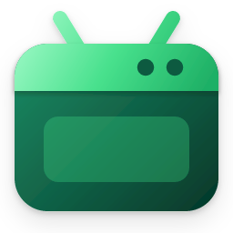
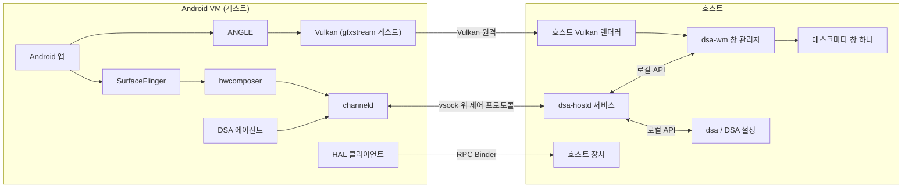

<div align="center">



# Desktop Subsystem for Android™

**Android 앱을 진짜 데스크톱 창으로, 오픈 소스로.**

[](https://github.com/thisisthepy/desktop-subsystem-for-android/actions/workflows/test.yml)
[](https://github.com/thisisthepy/desktop-subsystem-for-android/actions/workflows/test-installer.yml)
[](https://github.com/thisisthepy/desktop-subsystem-for-android/actions/workflows/test-image.yml)
[](https://github.com/thisisthepy/desktop-subsystem-for-android/actions/workflows/test-kernel.yml)
[](https://github.com/thisisthepy/desktop-subsystem-for-android/releases/latest)
[](https://github.com/thisisthepy/desktop-subsystem-for-android/blob/main/LICENSE)

[English](../../README.md) · **한국어** · [日本語](README_ja.md) · [简体中文](README_zh-CN.md) · [繁體中文](README_zh-TW.md) · [Español](README_es.md) · [Français](README_fr.md) · [Deutsch](README_de.md) · [Português (Brasil)](README_pt-BR.md) · [Русский](README_ru.md) · [Italiano](README_it.md) · [Tiếng Việt](README_vi.md) · [Bahasa Indonesia](README_id.md) · [Türkçe](README_tr.md)

</div>

> DSA는 독립 오픈 소스 프로젝트입니다. Microsoft나 Google과 제휴하거나 그들의 보증, 후원을
> 받지 않습니다. Android는 Google LLC의 상표입니다. Windows는 Microsoft 그룹의 상표입니다.

## 무엇인가

DSA는 Android를 전용 경량 VM에서 실행하고, Android 태스크마다 네이티브 데스크톱 창을
하나씩 보여 줍니다. 앱마다 작업 표시줄 단추, 시작 메뉴 항목, 알림, 설치된 앱 목록의 항목이
따로 있습니다. Microsoft가 2025년 3월 5일에 지원을 끝낸 Windows Subsystem for Android(WSA)와
같습니다. DSA는 모든 부분이 오픈 소스이므로 누구나 이어 갈 수 있습니다.

**상태.** DSA는 Windows 11의 x64 PC와 ARM64 PC에서 동작합니다. 1.0 전의 릴리스는
프리릴리스입니다. 1.0부터는 릴리스가 정식 채널과 프리릴리스 채널로 나뉩니다
([업데이트와 릴리스 채널](#업데이트와-릴리스-채널) 참고). 기능은 CI에서 테스트하고, 실제
하드웨어에서 손으로 하는 확인은 릴리스마다 이어집니다. 발견한 것이 있으면 알려 주세요.
Linux와 macOS는 진행 중이며 아직 배포하지 않았습니다([지원 플랫폼](#지원-플랫폼) 참고).

**DSA 1.0이 나왔습니다.** 첫 정식 릴리스로, Android 앱이 다시 Windows 데스크톱에서 앱마다
자기 창으로 열립니다. 출시 영상을 보세요.

[](https://www.youtube.com/watch?v=4VgRY6QKiwM)

## 지원 플랫폼

| 호스트 | 상태 |
|---|---|
| Windows 11, x64 | `DSA-v<version>-win-x64-setup.exe`로 배포합니다 |
| Windows 11, ARM64 | `DSA-v<version>-win-arm64-setup.exe`로 배포합니다. Android도 ARM64이므로 ARM 앱이 번역 없이 실행됩니다 |
| Linux (x64, ARM64) | 진행 중이며 아직 배포하지 않았습니다. KVM 호스트, Wayland 합성기, `.deb`와 `.rpm` 패키지를 CI에서 빌드하고 실행합니다 |
| macOS (Apple silicon) | 진행 중이며 아직 배포하지 않았습니다. Apple Virtualization 프레임워크 기반 호스트와 그 앱 번들을 CI에서 빌드합니다 |

### Android 버전

DSA는 가장 새로운 Android 메이저 버전 두 개를 지원합니다. 지금은 Android 16과 Android
17입니다. 한 버전은 두 단계 새로운 메이저가 나오면 지원이 끝나므로, Android 16은 Android 18이
출시될 때까지 지원합니다. 이미지 업데이터는 사용자를 지원되는 버전으로 옮기며, 더 낮은
메이저로는 스스로 옮기지 않습니다. 지원되는 두 버전 가운데 하나를 DSA 설정이나
`dsa android use`로 고를 수 있습니다. 더 오래된 버전으로 옮기면 Android 데이터가 지워집니다.
Android가 더 새 버전이 쓴 데이터를 읽지 못하기 때문입니다.

<p align="center">
  
</p>

오늘 이후의 날짜는 출시가 아니라 예정일입니다.

## 기능

**창과 입력**

- Android 태스크마다 네이티브 창 하나. 앱 모습 그대로 그리고, 작업 표시줄, Alt+Tab,
  작업 관리자에 앱 자신의 프로그램 이름과 아이콘이 보입니다. 화면 전체를 담는 에뮬레이터 틀은
  없습니다.
- 앱의 일부인 제목 표시줄. 앱의 색이 창 맨 위까지 닿고, 그 위에 Windows 11 캡션 단추가
  놓이며, 왼쪽에 앱의 아이콘과 이름이 있습니다. 앱이 뒤로 갈 수 있으면 아이콘이 뒤로 화살표로
  바뀝니다. 스냅 레이아웃, 끌기, 두 번 클릭해 최대화, 창 메뉴(Alt+Space)가 여느 Windows 앱처럼
  동작합니다.
- 창 메뉴에는 **전체 화면**, **새 창**(창 여러 개를 허용하는 앱), **스크린샷**, **화면 비율**,
  **링크 열기 설정**, **앱 정보**가 더해집니다.
- 앱을 다시 만들지 않는 실시간 크기 조정, 그리고 모니터의 작업 영역을 채우는 최대화.
- 동영상 플레이어의 전체 화면 단추처럼 앱이 전체 화면을 요청하면 화면 전체를 채웁니다.
  포인터가 위쪽 끝에 닿으면 제목 표시줄이 나타납니다. 짧은 동영상 피드처럼 막대만 숨기는 앱은
  창 안에 머뭅니다. 둘 다 DSA 설정에서 모든 앱에 대해, 또는 앱마다 고를 수 있고, F11은 언제나
  전체 화면을 켜고 끕니다.
- 모든 모니터에서 선명한 출력. 앱을 배율이 다른 모니터로 옮기면 창이 그 모니터에 닿는 대로
  새 배율로 다시 그리거나, DSA가 창을 늘이거나 줄입니다. 앱마다 고를 수 있고, 기본으로는 배율
  변화를 직접 처리한다고 밝힌 앱은 다시 그리고 다른 앱은 DSA가 맞춥니다. YouTube처럼 실행 중에
  배율이 바뀌면 깨지는 것으로 알려진 앱은 기본으로 DSA가 맞춥니다.
- 앱의 글자는 Windows 텍스트 크기 설정을 따릅니다.
- 마우스(호버 포함), 열 손가락까지의 터치, 펜(압력, 지우개, 배럴 단추), 모든 자판 배열의
  키보드.
- Windows 텍스트 서비스 프레임워크(TSF)를 통한 텍스트 입력. 한국어를 포함한 Windows 입력기가
  Android 편집기 안에서 바로 조합하고, 후보 창은 커서 옆에 뜹니다. 재변환, 터치 키보드, 음성
  입력(Win+H), 필기, 이모지 패널이 편집기의 실제 텍스트 위에서 동작합니다. Android 키보드
  앱은 없습니다.
- 파일 탐색기와 앱 창 사이에서 양방향으로 파일 끌어 놓기.
- DSA 창이 앞에 있는 동안 Windows 11의 세 손가락, 네 손가락 터치 제스처를 꺼서(기본값은 켬)
  앱이 받게 합니다.
- 앱마다 접근성 트리를 Windows UI Automation에 노출해 화면 읽기 프로그램과 자동화 도구가
  씁니다([UI Automation](#ui-automation), [접근성](#접근성) 참고).

**셸 통합**

- 모든 Android 앱의 시작 메뉴 항목과 Windows 검색(Android가 멈춘 동안에도). 앱은
  설정 > 앱 > 설치된 앱에 나오고 거기서 제거할 수 있습니다.
- 바탕 화면 바로 가기, 그리고 작업 표시줄과 시작 메뉴의 점프 목록에 있는 앱 자체의 바로
  가기(메신저의 새 채팅 등). 앱 이름이 바뀌면 시작 메뉴 항목, 바탕 화면 바로 가기, 작업
  표시줄 고정도 새 이름을 따릅니다.
- Android 알림을 앱마다 이름과 아이콘이 붙은 Windows 알림으로 표시. 누르면 앱이 열리고,
  닫으면 Android에서도 닫힙니다.
- 백그라운드에서 도는 앱은 알림 영역 아이콘으로, 미디어를 재생하는 앱은 미디어 키와 Windows
  미디어 컨트롤로.
- 바탕 화면에 놓는 Android 위젯. 위젯마다 자기 창이 있습니다.
- 양방향 텍스트 클립보드, Windows 브라우저로 여는 웹 링크, Android 앱으로 열고 공유하는
  Windows 파일, Android와 공유하는 Windows 폴더.
- 파일 탐색기 탐색 창의 **Android** 아래에 있는 Android 파일.
- 두 번 클릭, 상황에 맞는 메뉴, 창에 파일 끌어 놓기, `dsa install`로 하는 APK 설치. Android가
  시작하기 전에 APK가 무엇인지 보여 주는 창이 뜹니다.
- Android 공유 시트의 "PC에서 공유". 텍스트, 링크, 파일을 근거리 공유를 포함한 Windows 공유
  창으로 넘깁니다.

**미디어와 장치**

- Windows 기본 출력 장치와 입력 장치로 오가는 오디오. 볼륨 믹서에 앱마다 줄이 있습니다.
- Media Foundation으로 호스트 GPU에서 디코딩하는 동영상: H.264, HEVC, VP9, AV1, 최대
  4096x2304. 디코딩한 화면은 동영상 채널로 복사하지 않고, 호스트와 VM이 함께 쓰는 메모리
  영역으로 Android에 닿습니다. GPU가 디코딩하지 않는 형식은 Android 안에서 소프트웨어로
  디코딩합니다.
- 호스트에서 하는 GPU 렌더링: gfxstream을 통한 Vulkan 원격, 그 위에서 ANGLE을 통한 OpenGL ES.
- 카메라, 마이크, 위치, 센서(가속도계, 자이로스코프, 방향, 조도), 전원. 모두 Windows 개인
  정보 설정과 Android 권한을 함께 거칩니다.
- Android의 네트워크 위치는 Google Play가 있든 없든 호스트가 답합니다. Google Play가 없으면
  주소 변환(`Geocoder`)도 DSA에 함께 들어 있는 행정 경계 데이터로 컴퓨터 안에서 답합니다. 좌표가
  나라, 시도, 시로 바뀌고, 한국에서는 구와 읍면동까지 나옵니다. 서버와 키가 필요 없고 위치가
  컴퓨터 밖으로 나가지 않습니다. 번지 단위 주소와 주소를 좌표로 바꾸는 것은 제공하지 않습니다.
  Google Play가 있으면 Google의 주소 변환이 답합니다.

**시스템**

- 대기 상태는 Android의 Doze입니다. 마지막 Android 창을 닫거나 최소화하고 30초가 지나면
  Android가 Doze로 들어갑니다. CPU가 쉬는 동안에도 알림이 오고, 쓰지 않는 메모리는 Android가
  실행 중일 때도 Windows로 돌아갑니다. 앱을 열면 부팅을 기다리지 않고 바로 깨어납니다.
  Android 일시 정지는 선택 사항이며 기본값은 꺼짐입니다.
- Windows 사용자마다 자기 Android와 데이터 디스크를 자기 프로필에 가집니다.
- `sudo` 같은 루트 권한(기본값은 꺼짐). 관리자가 켜면 앱마다, 그리고 개발자 모드의
  `adb shell`을 묻기로 설정할 수 있습니다. 요청이 오면 앱 자신의 이름과 아이콘으로 Windows
  관리자 확인 창(UAC)이 뜨고, 승인은 15분 동안 유지됩니다. 허용되지 않은 앱에는 `su`가 아예
  보이지 않습니다. 모든 요청은 기록됩니다.
- 앱 데이터를 사용자 폴더에 암호화해 백업(기본값은 꺼짐).
- DSA 설정: 앱과 그 창, 백그라운드 앱, 위젯, 디스플레이와 GPU, 메모리, 네트워크, 기기 정보,
  업데이트, 추가 구성 요소, 루트 권한, adb를 포함한 개발자 모드, Android의 실시간 로그와 진단.
  여기 있는 모든 것은 `dsa` 명령으로도 쓸 수 있습니다.

**직접 고르는 추가 구성 요소**

DSA에는 Google 소프트웨어가 들어 있지 않습니다. 아래 구성 요소는 요청할 때만, DSA가 출처와
약관을 보여 준 뒤 출처에서 내려받아 Android 옆의 추가 구성 요소 디스크에 둡니다. 시스템
이미지는 바뀌지 않으며, 하나하나 DSA 설정이나 명령줄에서 다시 제거할 수 있습니다.

- **Google Play.** `dsa gapps install`이나 DSA 설정의 **고급** > **Google Play**가 내 Android
  버전에 맞는 공개 LiteGapps Core 패키지(Google Play 서비스, Play 스토어, 계정 동기화)를
  내려받습니다. 이 Android는 Google 인증을 받지 않았으므로 Google이 기기 등록을 요구할 수
  있습니다. DSA 설정이 Android ID와 등록할 페이지를 보여 줍니다. Google Play 때문에 Android가
  시작하지 못하는 일은 없습니다. Google 앱은 Google의 약관을 따릅니다.
- **Widevine L3.** `dsa drm widevine install`이나 **고급** > **보호된 콘텐츠**가 내 Android
  버전용 Google Android 에뮬레이터 이미지에서 Google의 Widevine 모듈을 바꾸지 않고
  꺼냅니다(내려받기 약 2GB, Widevine만 남깁니다). 그러면 스트리밍 앱이 보호된 동영상을 재생할
  수 있습니다. 보안 수준 L3에서는 스트리밍 서비스가 표준 화질까지만 보내므로, 고화질은 Windows
  브라우저나 앱으로 보세요.
- **ARM 번역.** x64 PC에서는 ARM 전용 앱이 번역기를 거쳐 실행됩니다. 오픈 소스 번역기
  [Digitalis](https://digitalisx64.github.io/)가 x64 이미지에 함께 들어 있어 처음 시작할 때부터 쓰입니다. Google의
  번역기(`dsa arm-translation fetch google`)나 직접 만든 패키지로 바꿀 수 있습니다. 64비트 ARM
  앱(`arm64-v8a`)만 실행됩니다. ARM64 PC에서는 Android가 ARM 앱을 직접 실행합니다.

**함께 배포하지 않는 것:** Google Play 서비스, 앱 스토어, 그 밖의 Google 바이너리(라이선스상
사용자가 선택할 일입니다), 그리고 Microsoft의 WSA 바이너리.

## UI Automation

DSA는 Android 앱 창 안의 사용자 인터페이스를 Windows 앱이 쓰는 것과 같은 인터페이스인
Windows UI Automation(UIA, UI 자동화)에 노출합니다. 화면 읽기 프로그램, 테스트 도구, 그 밖의
UIA 클라이언트는 Android 앱의 단추, 목록, 텍스트 필드를 그림 한 장이 아니라 창의 요소로 봅니다.

**동작 방식.** UIA 클라이언트가 DSA 앱 창에 처음 트리를 요청하면, 창은 Android 안의 DSA
에이전트에게 그 태스크를 지켜보라고 요청합니다. 에이전트는 그 태스크의 Android 접근성 노드만
읽어 호스트로 보냅니다. 처음에는 트리 전체를, 그다음에는 바뀐 부분을 보냅니다. 호스트는
트리를 창 프로세스에 두므로, 속성을 읽거나 탐색하는 호출은 모두 VM을 오가지 않고 그 자리에서
답합니다. UIA 클라이언트가 30초 동안 듣지 않으면 지켜보기가 멈추고, Android도 노드 읽기를
멈춥니다. UIA 클라이언트를 쓰지 않는 사용자에게는 아무 부담이 없습니다.

**각 요소가 담는 것.**

- **컨트롤 유형**: Android 뷰 클래스와 상태에서 정합니다. 단추, 확인란, 라디오 단추, 편집,
  슬라이더, 진행률 표시줄, 콤보 상자, 목록, 목록 항목, 탭, 메뉴, 이미지, 텍스트,
  문서(`WebView`), 도구 모음, 그룹. Android 스위치는 Toggle 패턴이 있는 단추이고, 제목은
  텍스트입니다.
- **Name**: 콘텐츠 설명, 없으면 텍스트, 그것도 없으면 빈 편집 필드의 힌트. 자기 이름이 없는
  클릭 가능한 요소는 자식들의 이름을 씁니다.
- **AutomationId**: `com.example:id/send` 같은 Android 뷰의 리소스 ID.
- **ClassName**: Android 뷰 클래스. **FrameworkId**는 `Android`입니다.
- **HelpText**(힌트), **ItemStatus**(Android의 상태 설명), **IsEnabled**,
  **IsKeyboardFocusable**, **HasKeyboardFocus**, **IsPassword**, 그리고 화면 좌표의
  **BoundingRectangle**.
- Android가 사용자에게 보이지 않는다고 알리는 요소는 트리에서 빠집니다.
- 비밀번호 필드는 결코 텍스트로 Android 밖에 나가지 않습니다. 글자마다 점(•)으로 옵니다.

**패턴과 Android에서 하는 일.**

| UIA 패턴 | Android 동작 |
|---|---|
| Invoke | `ACTION_CLICK` |
| Value (`SetValue`) | `ACTION_SET_TEXT`. 필드의 텍스트 전체를 바꿉니다 |
| Toggle | `ACTION_CLICK` |
| SelectionItem (`Select`) | `ACTION_SELECT`. 노드에 선택 동작이 없으면 `ACTION_CLICK` |
| Scroll | 페이지 단위의 `ACTION_SCROLL_FORWARD`와 `ACTION_SCROLL_BACKWARD`. 스크롤 비율은 없습니다 |
| `SetFocus` | `ACTION_FOCUS`. 노드가 입력 포커스를 받을 수 없으면 `ACTION_ACCESSIBILITY_FOCUS` |

이 동작은 노드에 바로 전달됩니다. 마우스를 움직이거나 터치를 주입하지 않습니다.

**이벤트.** 창은 포커스 변경(창이 앞에 있는 동안), 자식이 생기거나 사라질 때의 구조 변경,
그리고 이름, 값, 토글 상태, 선택, 사용 가능 상태, 경계 사각형의 속성 변경 이벤트를 냅니다.
이벤트는 클라이언트가 듣는 동안에만 냅니다.

**텍스트 입력.** `SetValue`는 필드의 텍스트를 한 번에 정합니다. 타이핑, 조합, 입력기는 키보드
앞에 앉은 사람의 입력처럼 TSF와 앱의 `InputConnection`을 거칩니다.

**창 자체.** 창의 이름은 앱의 이름입니다. 캡션 단추(최소화, 최대화 또는 복원, 닫기)와 제목
표시줄의 뒤로 화살표는 트리에서 이름이 있는 단추입니다.

**다른 도구에서 쓰기.** Inspect, Accessibility Insights for Windows 같은 도구나 FlaUI 같은
라이브러리 등 어떤 UIA 클라이언트든 쓸 수 있습니다. 앱의 창을 이름으로 찾은 뒤, 요소를
AutomationId, 이름, 컨트롤 유형으로 찾습니다. 요소가 아니라 한 지점을 눌러야 하는 스크립트는
`dsa tap <package> <x> <y>`로 앱의 태스크 안을 누릅니다.

**아직 없는 것.** Text 패턴, RangeValue나 ExpandCollapse 패턴, UIA를 통한 길게 누르기, 제목
수준, 알림이나 라이브 영역 이벤트가 없습니다. Android의 접근성 포커스는 내보내지 않고 입력
포커스만 내보냅니다. 개선은 이슈
[#744](https://github.com/thisisthepy/desktop-subsystem-for-android/issues/744)(열림)에서
추적합니다.

## 접근성

**화면 읽기 프로그램.** NVDA와 내레이터(Narrator)는 위의 UI Automation 트리로 Android 앱을
읽습니다. 컨트롤에 이름과 역할이 있고, 포커스가 키보드를 따르며, 단추, 스위치, 목록, 텍스트
필드를 마우스 없이 쓸 수 있습니다. JAWS도 같은 트리를 씁니다. 프로젝트에서 아직 확인하지
않았으므로 알려 주시면 반갑겠습니다.

**개선 중인 것.** 아래 항목은 화면 읽기 프로그램 사용자의 보고인 이슈
[#744](https://github.com/thisisthepy/desktop-subsystem-for-android/issues/744)에서 나왔습니다.
모두 열려 있으며 거기서 추적합니다.

- **더 빠른 포커스.** 지금은 포커스 변경이 Android에서 기다렸다가 Windows에 닿아, 키를 누르고
  약 250~450ms 뒤에 도착합니다. 화살표 키를 누르고 있으면 1초에 약 네 단계씩 움직입니다.
  포커스 변경을 바로 보내고, 이벤트가 나온 태스크만 읽고, 짧은 시간 간격은 UIA 클라이언트가
  듣는 동안에만 쓰는 것이 계획입니다.
- **접근성 포커스.** 지금은 입력 포커스만 내보내므로, Android의 접근성 포커스가 움직여도
  포커스 이벤트가 나지 않습니다.
- **Text 패턴.** 편집 필드에는 아직 Text 패턴이 없습니다. NVDA는 이 패턴으로 글자, 단어, 줄
  단위로 텍스트를 읽고 살펴봅니다. 값은 읽고 정할 수 있습니다.

**DSA 자체의 창.**

- **DSA 설정**은 키보드와 화면 읽기 프로그램으로 쓸 수 있습니다. 탐색, 행, 컨트롤이 이름 있는
  UIA 요소입니다.
- **APK 설치 관리자**는 모든 요소에 이름이 있고, **More** 링크는 UIA로 펼치고 접을 수 있습니다.
- **바탕 화면의 위젯**은 키보드 포커스를 받습니다. Enter, Space, 메뉴 키, Shift+F10으로 위젯의
  메뉴가 열립니다.
- 위젯과 알림 영역 아이콘의 **메뉴**는 키보드로 탐색하는 UIA 메뉴이고, **확인 대화 상자**에는
  선택키와 기본 단추가 있습니다.
- **루트 확인 창**은 Windows 자체의 관리자 확인 창(UAC)입니다.
- 고대비 테마에서는 캡션 단추가 시스템 색을 씁니다.

Linux에서는 호스트가 같은 트리를 AT-SPI로 내보내며, Orca를 위해 글자, 단어, 줄 단위의 텍스트도
제공합니다. Linux는 아직 배포하지 않았습니다. macOS 호스트는 아직 앱 트리를 내보내지 않습니다.

**문제 알리기.** 화면 읽기 프로그램과 그 버전, 앱, 한 일, 들은 것, 기대한 것을 적어
[이슈](https://github.com/thisisthepy/desktop-subsystem-for-android/issues/new)를 올려 주세요.
`dsa logs collect -o diag.zip`으로 만든 진단 묶음이 도움이 됩니다. 질문은
[DSA Discord](https://discord.gg/MtpQnR4eQQ)에서도 받습니다.

## 설치

**필요한 것:** x64 또는 ARM64 PC의 Windows 11, 그리고 Windows 기능 **가상 머신 플랫폼**이
켜져 있어야 합니다. 설치 프로그램이 이를 확인하고, 꺼져 있으면 안내와 함께 멈춥니다.

1. **가상 머신 플랫폼**을 켭니다. 설정 > 시스템 > 선택적 기능 > 기타 Windows 기능에서
   켜거나, 관리자 터미널에서 `dism /online /enable-feature /featurename:VirtualMachinePlatform /all`을
   실행합니다. 그다음 다시 시작합니다.
2. [최신 릴리스](https://github.com/thisisthepy/desktop-subsystem-for-android/releases/latest)에서
   `DSA-v<version>-win-x64-setup.exe`(ARM64 PC에서는 `DSA-v<version>-win-arm64-setup.exe`)를
   내려받고 `SHA256SUMS.txt`와 대조합니다.
3. 실행합니다. 설치 프로그램이 `DsaHost` 서비스, `dsa` 명령, DSA 설정, APK 설치 관리자, 첫
   Android 이미지(설치 파일에 없으면 내려받습니다)를 설치합니다. Android는 로그인할 때
   시작하므로, 처음 여는 앱이 부팅을 기다리지 않습니다.

커널을 빌드할 필요도, WSL 설정을 바꿀 필요도 없습니다. DSA는 자체 커널과 자체 VM을 씁니다.
제거하면 각 사용자의 Android 디스크를 빼고 DSA가 쓴 모든 것이 지워집니다.

## 업데이트와 릴리스 채널

DSA는 자기 자신과 Android 이미지를 업데이트합니다. 둘 다 서명되어 있으며, 서명, 크기, 해시가
맞지 않으면 아무것도 적용하지 않습니다.

- **DSA 자체.** 서비스가 서명된 릴리스 목록을 확인하고, 실행 중인 사용자의 Android가 없을 때
  새 버전을 설치합니다. 실행 중이면 기다리며, `dsa update`는 바로 설치합니다. 설치 전후에
  알려 줍니다. 업데이트가 DSA를 더 낮은 버전으로 옮기는 일은 없습니다.
- **채널.** 1.0부터 두 가지가 있습니다. **정식**(stable), 그리고 아직 다듬는 중인 버전을 위한
  **프리릴리스**(pre-release)입니다. 프리릴리스 채널은 둘 중 더 새 버전을 받습니다. 채널은
  처음 쓴 설치 파일에 따라 정해지고, 업그레이드해도 유지됩니다. DSA 설정 **업데이트** 페이지의
  **프리릴리스 버전 받기**나 `dsa settings set prerelease-updates on|off`(관리자)로 바꿉니다.
  프리릴리스를 그만 받아도 DSA는 이전 버전으로 돌아가지 않고, 더 새 정식 릴리스를 기다립니다.
  1.0 전의 모든 릴리스는 프리릴리스입니다.
- **Android 이미지.** 이미지 업데이트는 채널과 상관없습니다. 부팅에 실패한 이미지는 마지막으로
  정상이던 이미지로 바뀌고, `dsa status`가 이를 알려 줍니다. **업데이트 시 Android 자동으로 다시
  시작**을 켜 두면, 열린 앱 창이 없을 때 내려받은 업데이트로 Android가 다시 시작합니다.
- **업데이트 끄기.** 관리자는 **업데이트** 페이지에서 **DSA 자동 업데이트**와 **Android 이미지
  자동 업데이트**를 끌 수 있습니다.

정식 릴리스는 검토를 거쳐 `main`에서만 만듭니다. `develop`의 빌드는 프리릴리스이거나 기여자를
위한 테스트 빌드입니다.

## 빠른 시작

시작 메뉴에서 Android 앱을 열거나 `dsa` 명령을 씁니다.

```
dsa status                          # Android 상태와 대기 중인 업데이트
dsa install app.apk                 # APK나 분할 APK 묶음(.xapk, .apks, .apkm) 설치
dsa apps list                       # 설치된 앱
dsa launch com.android.settings     # 앱을 자기 창으로 열기
dsa settings set clipboard off      # 설정 바꾸기(DSA 설정에도 같은 스위치가 있습니다)
dsa logcat -d -b all *:W            # Android 로그, 경고 이상
dsa logs collect -o diag.zip        # 문제 보고에 필요한 모든 것을 zip 하나로
```

인자 없이 `dsa`를 실행하면 모든 명령이 나옵니다. Android 로그는 메모리에만 있고, 누군가
읽는 동안에만 호스트로 흐릅니다. 문제를 보고할 때 `diag.zip`을 첨부해 주세요.

## 제한 사항

지금은 다음과 같습니다.

- Windows만 배포합니다. Linux와 macOS는 진행 중입니다.
- DSA 설정은 영어와 한국어로만 표시됩니다.
- 64비트 앱만 실행됩니다: `arm64-v8a`, 그리고 x64에서는 `x86_64`. 32비트 앱은 실행되지
  않습니다.
- Widevine은 L3이므로 보호된 스트림은 표준 화질까지만 재생됩니다.
- DSA의 Google Play는 Google 인증을 받지 않았습니다. Google이 기기 등록을 요구할 수 있습니다.
- 클립보드는 텍스트만 공유합니다.
- **시스템(강제)** 크기 조정은 아직 쓸 수 없고 **시스템**처럼 동작합니다.
- UI Automation 내보내기에는 [UI Automation](#ui-automation)에 적은 빈 곳이 있습니다.
- Google Play 없이 하는 주소 변환은 번지 단위 주소가 아니라 지역(나라에서 시까지, 한국에서는
  구까지)을 알려 줍니다.

## 사용 안내서

설치, 앱과 창, APK, 파일, Android 버전, 설정, 메모리, 개발자 모드, 문제 해결, 제거를 차례대로
설명하는 안내서가 [docs/guides/ko](../guides/ko/README.md)에 있습니다.
[소개 페이지](../guides/intro/index.html#ko)는 처음 접하는 분께 프로젝트를 설명합니다.

## 아키텍처



- **게스트.** 플랫폼 서명된 에이전트가 디스플레이를 자유형으로 만들고 태스크, 앱, 알림, 접근성
  트리를 알립니다. hwcomposer는 태스크마다 레이어를 자기 디스플레이로 호스트에 넘깁니다. HAL
  클라이언트는 RPC Binder로 호스트 장치에 닿습니다. 런처, 상태 표시줄, 키보드 앱은 없습니다.
  셸은 호스트입니다.
- **프로토콜.** 정의는 `dsa/protocol/control.proto` 하나이고, Rust, Java, C++ 코덱을 여기서
  생성합니다. 모든 연결은 프로토콜 버전, 스키마 해시, 부팅마다 바뀌는 비밀 값을 확인합니다.
- **호스트.** `dsa/host/core/`는 플랫폼 중립입니다: 세션, 앱 목록, 수명 주기 정책. 각 OS는
  `dsa/host/platform/<os>/`에 VM, 전송 계층, 창 시스템을 더합니다. Windows에서는 Host Compute
  System으로 VM을 만들고, 프레임은 CPU를 거치지 않고 Direct3D 11과 DirectComposition으로 GPU에서
  각 창으로 갑니다.

## 소스에서 빌드

Rust 크레이트는 `dsa/`의 워크스페이스 하나입니다.

```
cd dsa
cargo test --workspace
cargo build -p dsa-host-windows --release
```

다른 부분은 각자 옆에 설명된 빌드가 있습니다.

- 설치 프로그램: `dsa/host/platform/windows/installer/README.md`
- Windows 호스트: `dsa/host/platform/windows/README.md`
- 게스트 커널: `dsa/kernel/`
- Android 이미지와 게스트 구성 요소: `dsa/guest/`
- 그래픽 경로: `dsa/graphics/`

상위 프로젝트(AOSP, gfxstream, 커널)는 저장소에 넣지 않습니다. 스크립트가 고정된 리비전을
받아 이 저장소의 패치를 적용합니다. Python 도구는 `uv run`으로 실행합니다.

## 저장소 구성

| 경로 | 내용 |
|---|---|
| `dsa/protocol/` | 게스트와 호스트의 제어 프로토콜과 코드 생성기 |
| `dsa/host/core/` | 플랫폼 중립 호스트 |
| `dsa/host/cli/` | `dsa` 명령 |
| `dsa/host/platform/windows/` | Windows 호스트, 창 관리자, 설치 프로그램, DSA 설정 |
| `dsa/host/platform/linux/`, `macos/`, `unix/` | Linux와 macOS 호스트, 그리고 둘이 공유하는 부분 |
| `dsa/graphics/` | gfxstream에서 시작한 Vulkan 원격 |
| `dsa/guest/` | 에이전트, hwcomposer, HAL 서비스, 이미지 구성 |
| `dsa/kernel/` | 게스트 커널 구성과 빌드 |
| `scripts/tests/` | 저장소 검사 |
| `.github/` | CI 워크플로, 릴리스 스크립트, README 자료 |

## 기여

DSA는 아직 초기이고 안정화 중이라, 고칠 방법을 몰라도 알려 주시는 것 하나하나가 큰 도움이
됩니다.

<p>
  <a href="https://github.com/thisisthepy/desktop-subsystem-for-android/issues/new"></a>
  <a href="https://discord.gg/MtpQnR4eQQ"></a>
</p>

- **버그를 찾았거나 아이디어가 있나요?** [이슈를 올려 주세요](https://github.com/thisisthepy/desktop-subsystem-for-android/issues/new). 무엇을
  했고 어떻게 되었는지와 함께 Windows 빌드(`winver`), DSA와 Android 버전(`dsa status`)을
  적어 주세요. `dsa logs collect -o diag.zip`으로 만든 진단 묶음이 있으면 원인을 훨씬 빨리
  찾을 수 있습니다.
- **먼저 물어보거나 이야기 나누고 싶나요?** [DSA Discord](https://discord.gg/MtpQnR4eQQ)에 남겨 주세요. 궁금한
  점, 돌려 보려는 앱, 써 본 소감 모두 반갑습니다.
- **변경을 보내 주시나요?** 작업은 `develop` 브랜치에서 하고, `main`은 거기서 게시합니다.
  풀 리퀘스트는 `develop`으로 열어 주세요. 커밋 하나에 논리적 변경 하나, 동작 변경마다
  테스트 하나를 둡니다. 생성된 프로토콜 코드는 손으로 고치지 않습니다. 글에 em 대시를 쓰지
  말아 주세요. 저장소 검사가 거부합니다.

## 라이선스

[Apache-2.0](https://github.com/thisisthepy/desktop-subsystem-for-android/blob/main/LICENSE).
함께 배포하는 서드파티 구성 요소는 각자의 라이선스를 따르며, 설치 프로그램에 목록이 있습니다.

## 상표

Android는 Google LLC의 상표입니다. Windows는 Microsoft 그룹의 상표입니다. DSA는 Microsoft나
Google과 제휴하거나 그들의 보증, 후원을 받지 않습니다.

## 스타 추이

<a href="https://www.star-history.com/#thisisthepy/desktop-subsystem-for-android&Date">
  <picture>
    <source media="(prefers-color-scheme: dark)" srcset="https://api.star-history.com/svg?repos=thisisthepy/desktop-subsystem-for-android&type=Date&theme=dark" />
    <source media="(prefers-color-scheme: light)" srcset="https://api.star-history.com/svg?repos=thisisthepy/desktop-subsystem-for-android&type=Date" />
    
  </picture>
</a>
