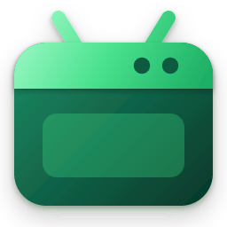
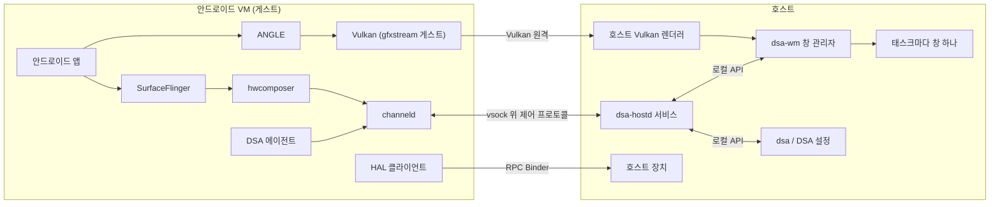

<div align="center">



# Desktop Subsystem for Android™

**안드로이드 앱을 진짜 데스크톱 창으로, 오픈 소스로.**

[](https://github.com/thisisthepy/desktop-subsystem-for-android/actions/workflows/test.yml)
[](https://github.com/thisisthepy/desktop-subsystem-for-android/actions/workflows/test-installer.yml)
[](https://github.com/thisisthepy/desktop-subsystem-for-android/actions/workflows/test-image.yml)
[](https://github.com/thisisthepy/desktop-subsystem-for-android/actions/workflows/test-kernel.yml)
[](https://github.com/thisisthepy/desktop-subsystem-for-android/releases/latest)
[](https://github.com/thisisthepy/desktop-subsystem-for-android/blob/main/LICENSE)

[English](https://github.com/thisisthepy/desktop-subsystem-for-android/blob/main/README.md) · **한국어**

</div>

> DSA는 독립 오픈 소스 프로젝트입니다. Microsoft나 Google과 제휴하거나 그들의 보증, 후원을
> 받지 않습니다. Android는 Google LLC의 상표입니다. Windows는 Microsoft 그룹의 상표입니다.

## 무엇인가

DSA는 안드로이드를 전용 경량 VM에서 실행하고, 안드로이드 태스크마다 네이티브 데스크톱 창을
하나씩 보여 줍니다. 앱마다 작업 표시줄 단추, 시작 메뉴 항목, 알림, 설치된 앱 목록의 항목이
따로 있습니다. Microsoft가 2025년 3월 5일에 지원을 끝낸 Windows Subsystem for Android(WSA)와
같습니다. DSA는 모든 부분이 오픈 소스이므로 누구나 이어 갈 수 있습니다.

**상태: 프리뷰.** DSA v0.1은 Windows 11 x64에서 동작합니다. 아래 기능은 구현되어 CI에서
테스트합니다. 실제 하드웨어에서 손으로 하는 확인은 진행 중이므로 다듬어지지 않은 부분이
있습니다. Linux, macOS, ARM64 Windows는 진행 중입니다([지원 플랫폼](#지원-플랫폼) 참고).

## 기능

**창과 입력**

- 안드로이드 태스크마다 네이티브 창 하나. 앱 모습 그대로 그리고, 작업 표시줄, Alt+Tab,
  작업 관리자에 앱 자신의 프로그램 이름과 아이콘이 보입니다. 화면 전체를 담는 에뮬레이터 틀은
  없습니다.
- 앱 위에 Windows 11 캡션 단추, 스냅 레이아웃, 앱을 다시 만들지 않는 실시간 크기 변경, 모든
  모니터 배율에서 선명한 출력.
- 마우스, 터치, 펜(압력, 지우개, 배럴 단추), 모든 자판 배열의 키보드, 그리고 한국어를 포함한
  Windows 입력기를 안드로이드 편집기로 전달.
- UI 자동화에 창을 노출해 화면 낭독기가 읽을 수 있습니다.

**셸 통합**

- 모든 안드로이드 앱의 시작 메뉴 바로 가기와 Windows 검색(안드로이드가 멈춘 동안에도). 앱은
  설정 > 앱 > 설치된 앱에 나오고 거기서 제거할 수 있습니다.
- 안드로이드 알림을 앱 이름과 아이콘으로 Windows 알림 창에 표시. 누르면 앱이 열리고, 닫으면
  안드로이드에서도 닫힙니다.
- 백그라운드에서 도는 앱은 알림 영역 아이콘으로, 미디어를 재생하는 앱은 미디어 키와 미디어
  플라이아웃으로.
- 바탕 화면에 놓는 안드로이드 위젯.
- 양방향 텍스트 클립보드, 호스트 브라우저로 여는 링크, 안드로이드 앱으로 열고 공유하는 호스트
  파일, 공유 폴더.
- 두 번 클릭, 상황에 맞는 메뉴, `dsa install`로 하는 APK 설치.

**시스템**

- 대기 상태는 안드로이드의 Doze입니다. CPU가 쉬는 동안에도 알림이 오고, 쓰지 않는 메모리는
  호스트로 돌아갑니다. 안드로이드 동결은 선택 사항이며 기본값은 꺼짐입니다.
- 안드로이드에 빌려주는 호스트 장치: GPU(gfxstream을 통한 Vulkan 원격, ANGLE을 통한 OpenGL
  ES), 오디오, 동영상 코덱, 마이크, 카메라, 위치, 센서, 전원.
- x64에서 ARM 전용 앱을 위한 ARM 번역 계층. x64 이미지에 오픈 소스 번역기 Digitalis가 함께 들어 있고,
  Google의 번역기나 다른 묶음으로 바꿀 수 있습니다.
- 안드로이드 이미지와 DSA 자체의 서명된 자동 업데이트. 실패한 이미지는 마지막으로 정상이던
  이미지로 되돌립니다.
- Windows 사용자마다 자기 안드로이드와 데이터 디스크를 자기 프로필에 가집니다.
- DSA 설정: 앱, 백그라운드 앱, 위젯, 디스플레이와 GPU, 메모리, 네트워크, 기기 정체성,
  업데이트, adb를 포함한 개발자 모드, 안드로이드의 실시간 로그와 진단.

**함께 배포하지 않는 것:** Google Play 서비스와 앱 스토어(라이선스상 사용자가 선택할
일입니다), 그리고 Microsoft의 WSA 바이너리. Google Play가 필요한 사용자는 DSA 설정이나
`dsa gapps install`로 설치합니다. 그러면 DSA가 공개된 LiteGapps Core 패키지를 그 사용자의
안드로이드에 맞게 내려받아 시스템 위에 얹습니다. Google 앱은 Google의 약관을 따릅니다.

## 지원 플랫폼

| 호스트 | 상태 |
|---|---|
| Windows 11, x64 | 프리뷰. `DSA-v<version>-win-x64-setup.exe`로 배포합니다 |
| Windows 11, ARM64 | 진행 중. CI에서 빌드하고 설치합니다. 아직 배포하지 않았습니다 |
| Linux (x64, ARM64) | 진행 중. KVM 호스트, Wayland 합성기, `.deb`/`.rpm` 패키지를 CI에서 빌드하고 실행합니다. 아직 배포하지 않았습니다 |
| macOS (Apple silicon) | 진행 중. Apple Virtualization 프레임워크 기반 호스트와 앱 번들을 CI에서 빌드합니다. 아직 배포하지 않았습니다 |

### 안드로이드 버전

DSA는 가장 새로운 안드로이드 메이저 버전 두 개를 지원합니다. 지금은 Android 16과 Android
17입니다. 한 버전은 두 단계 새로운 메이저가 나오면 지원이 끝나므로, Android 16은 Android 18이
출시될 때까지 지원합니다. 이미지 업데이터는 사용자를 지원되는 버전으로 옮기며, 더 낮은
메이저로는 스스로 옮기지 않습니다. 지원되는 두 버전 가운데 하나를 설정 앱이나
`dsa android use`로 고를 수 있습니다. 더 오래된 버전으로 옮기면 안드로이드 데이터가 지워집니다.
안드로이드가 더 새 버전이 쓴 데이터를 읽지 못하기 때문입니다.

<p align="center">
  
</p>

오늘 이후의 날짜는 출시가 아니라 예정일입니다.

## 설치

1. Windows 기능 **가상 머신 플랫폼**을 켜고 다시 시작합니다.
2. [최신 릴리스](https://github.com/thisisthepy/desktop-subsystem-for-android/releases/latest)에서
   `DSA-v<version>-win-x64-setup.exe`를 내려받고 `SHA256SUMS.txt`와 대조합니다.
3. 실행합니다. 설치 프로그램이 `DsaHost` 서비스, `dsa` 명령, DSA 설정, 첫 안드로이드
   이미지(설치 파일에 없으면 내려받습니다)를 설치합니다. 안드로이드는 로그인할 때 시작합니다.

커널을 빌드할 필요도, WSL 설정을 바꿀 필요도 없습니다. DSA는 자체 커널과 자체 VM을 씁니다.
제거하면 각 사용자의 안드로이드 디스크를 빼고 DSA가 쓴 모든 것이 지워집니다.

## 빠른 시작

시작 메뉴에서 안드로이드 앱을 열거나 `dsa` 명령을 씁니다:

```
dsa status                          # 안드로이드 상태와 대기 중인 업데이트
dsa install app.apk                 # APK나 분할 APK 묶음(.xapk, .apks, .apkm) 설치
dsa apps list                       # 설치된 앱
dsa launch com.android.settings     # 앱을 자기 창으로 열기
dsa settings set clipboard off      # 설정 바꾸기(DSA 설정에도 같은 스위치가 있습니다)
dsa logcat -d -b all *:W            # 안드로이드 로그, 경고 이상
dsa logs collect -o diag.zip        # 문제 보고에 필요한 모든 것을 zip 하나로
```

인자 없이 `dsa`를 실행하면 모든 명령이 나옵니다. 안드로이드 로그는 메모리에만 있고, 누군가
읽는 동안에만 호스트로 흐릅니다. 문제를 보고할 때 `diag.zip`을 첨부해 주세요.

## 사용 안내서

설치, 앱과 창, APK, 파일, Android 버전, 설정, 메모리, 개발자 모드, 문제 해결, 제거를 차례대로
설명하는 안내서가 [docs/guides/ko](../guides/ko/README.md)에 있습니다.
[소개 페이지](../guides/intro/index.html#ko)는 처음 접하는 분께 프로젝트를 설명합니다.

## 아키텍처



- **게스트.** 플랫폼 서명된 에이전트가 디스플레이를 자유형으로 만들고 태스크, 앱, 알림을
  알립니다. hwcomposer는 태스크마다 레이어를 자기 디스플레이로 호스트에 넘깁니다. HAL
  클라이언트는 RPC Binder로 호스트 장치에 닿습니다. 런처, 상태 표시줄, 키보드 앱은 없습니다.
  셸은 호스트입니다.
- **프로토콜.** 정의는 `dsa/protocol/control.proto` 하나이고, Rust, Java, C++ 코덱을 여기서
  생성합니다. 모든 연결은 프로토콜 버전, 스키마 해시, 부팅마다 바뀌는 비밀 값을 확인합니다.
- **호스트.** `dsa/host/core/`는 플랫폼 중립입니다: 세션, 앱 목록, 수명 주기 정책. 각 OS는
  `dsa/host/platform/<os>/`에 VM, 전송 계층, 창 시스템을 더합니다. Windows에서는 Host Compute
  System으로 VM을 만들고, 프레임은 CPU를 거치지 않고 Direct3D 11과 DirectComposition으로 GPU에서
  각 창으로 갑니다.

## 소스에서 빌드

Rust 크레이트는 `dsa/`의 워크스페이스 하나입니다:

```
cd dsa
cargo test --workspace
cargo build -p dsa-host-windows --release
```

다른 부분은 각자 옆에 설명된 빌드가 있습니다:

- 설치 프로그램: `dsa/host/platform/windows/installer/README.md`
- Windows 호스트: `dsa/host/platform/windows/README.md`
- 게스트 커널: `dsa/kernel/`
- 안드로이드 이미지와 게스트 구성 요소: `dsa/guest/`
- 그래픽 경로: `dsa/graphics/`

상위 프로젝트(AOSP, gfxstream, 커널)는 저장소에 넣지 않습니다. 스크립트가 고정된 리비전을
받아 이 저장소의 패치를 적용합니다. Python 도구는 `uv run`으로 실행합니다.

## 저장소 구성

| 경로 | 내용 |
|---|---|
| `dsa/protocol/` | 게스트와 호스트의 제어 프로토콜과 코드 생성기 |
| `dsa/host/core/` | 플랫폼 중립 호스트 |
| `dsa/host/cli/` | `dsa` 명령 |
| `dsa/host/platform/windows/` | Windows 호스트, 창 관리자, 설치 프로그램, DSA 설정 |
| `dsa/host/platform/linux/`, `macos/`, `unix/` | Linux와 macOS 호스트, 그리고 둘이 공유하는 부분 |
| `dsa/graphics/` | gfxstream에서 시작한 Vulkan 원격 |
| `dsa/guest/` | 에이전트, hwcomposer, HAL 서비스, 이미지 구성 |
| `dsa/kernel/` | 게스트 커널 구성과 빌드 |
| `scripts/tests/` | 저장소 검사 |
| `.github/` | CI 워크플로, 릴리스 스크립트, README 자료 |

## 기여

작업은 `develop` 브랜치에서 하고, `main`은 거기서 게시합니다. 풀 리퀘스트는 `develop`으로
열어 주세요. 커밋 하나에 논리적 변경 하나, 동작 변경마다 테스트 하나를 둡니다. 생성된 프로토콜
코드는 손으로 고치지 않습니다. 글에 em 대시를 쓰지 말아 주세요. 저장소 검사가 거부합니다.

## 라이선스

[Apache-2.0](https://github.com/thisisthepy/desktop-subsystem-for-android/blob/main/LICENSE).
함께 배포하는 서드파티 구성 요소는 각자의 라이선스를 따르며, 설치 프로그램에 목록이 있습니다.

## 상표

Android는 Google LLC의 상표입니다. Windows는 Microsoft 그룹의 상표입니다. DSA는 Microsoft나
Google과 제휴하거나 그들의 보증, 후원을 받지 않습니다.
